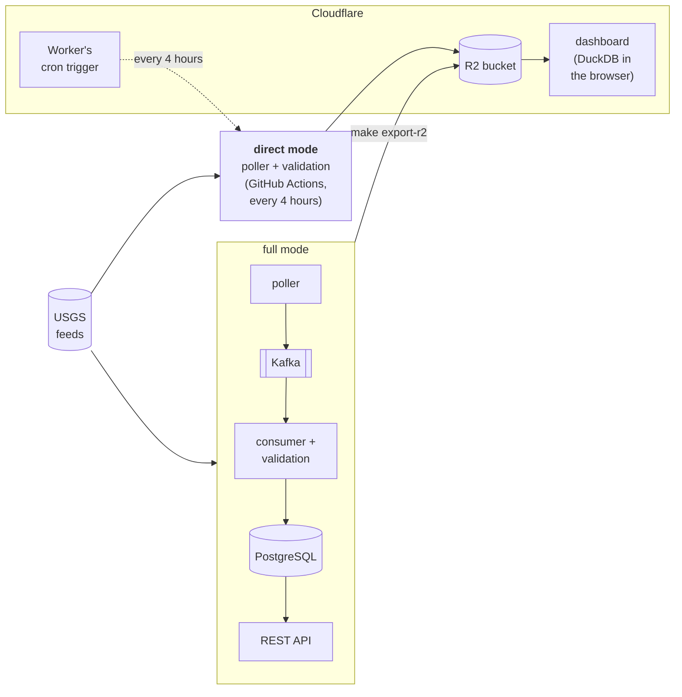
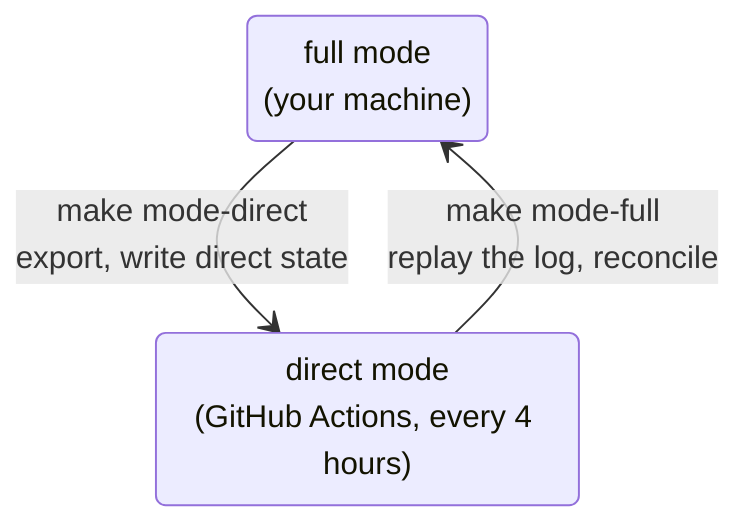

# Earth Hub

A local-first earthquake data platform, built as a QA engineering portfolio project. The live USGS feed flows through Apache Kafka into validated PostgreSQL tables. A read-only REST API serves them, and a public dashboard shows them from an export to Cloudflare R2. The point is less the pipeline than the evidence that it works: every requirement traces to a passing test, every defect found is logged with how it was found and how it was fixed, and CI runs the regression on every pull request.

**Status:** Milestones 1 to 8 are complete. Released on 2026-10-29 as [v1.0.0](https://github.com/dienarvaez1/earth-hub/releases/tag/v1.0.0): the repository is public, `main` is protected (CI must pass), and direct mode's R2 credentials are in an environment only `main` can use. Milestone 8 adds a second mode that runs without Docker, keeps its state in R2, and runs every 4 hours on GitHub Actions, started by a Cloudflare cron trigger, with an audit record of every run ([status](docs/progress/plan.md#status)). The dashboard runs at **https://earth-hub.diego-narvaez.workers.dev**, shared by link and kept out of search engines.

## For reviewers

| If you have | Start with |
| --- | --- |
| 2 minutes | [Quality at a glance](#quality-at-a-glance), then the [defect log](docs/progress/defects.md) |
| 10 minutes | The [demo walkthrough](docs/overview/demo.md): start it, run the tests, ingest the live feed, inspect what was stored and why, query the API, break something on purpose |
| An hour | The [architecture](docs/technical/architecture.md), the [test strategy](docs/progress/test-strategy.md), the [requirements](docs/progress/requirements.md) and their [traceability matrix](docs/progress/traceability-matrix.md), and [how Claude Code was used](#how-claude-code-was-used) |



Two modes write the same bucket, one at a time: **full** (the whole pipeline, on a developer machine) and **direct** (no Docker, Kafka or PostgreSQL, run every 4 hours on GitHub Actions, started by a Cloudflare cron trigger, so the dashboard stays current with no machine on). A marker in the bucket says which one; the handovers check both agree before switching:



## Quality at a glance

| | |
| --- | --- |
| **Requirements** | 200 requirements, each with a stable ID and at least one passing test that names it (`@pytest.mark.req`). A test naming an unknown ID fails at collection, and `make traceability` fails if any requirement has no passing test |
| **Tests** | About 1,200, in eight layers: unit, integration, API, contract (Schemathesis), end-to-end, dashboard (in Chromium), disruptive (real outages) and performance. About 92% coverage across all layers |
| **Defects** | 65 defects found, 63 fixed and 2 open (DEF-066, DEF-067), each with its milestone, severity, how it was found and the commit that fixed it; [six written up in full](docs/progress/defects.md) with root cause and prevention (kept in the git history) |
| **CI** | On every pull request and push to `main`, lint and unit tests, then the regression of every layer except performance in parallel parts (about 10 minutes), from the example settings and with no secrets; `main` accepts only changes that pass ([docs/technical/ci.md](docs/technical/ci.md)) |
| **Data integrity** | Kafka offsets committed only after the database; idempotent upserts; newer revisions win; `make reconcile` compares each topic with the database. The guarantee claimed is at-least-once, never exactly-once |
| **Recovery** | PostgreSQL stopped while events arrive, a Kafka restart, crashes between the two commits, poller and consumer restarts: each tested, and each ending in a reconciliation |
| **Static analysis and security** | Ruff with complexity, security, simplification and Pylint rules in `make lint`; GitHub's CodeQL code scanning, Dependabot alerts and secret scanning with push protection, with every finding triaged |
| **Privacy** | The dashboard sets no cookies, stores nothing in the browser, has no tracking and never asks for the visitor's location; its Worker logs no visitor requests ([privacy](#privacy)) |
| **Docs that can't drift** | The [API examples](docs/technical/api.md) and [SQL examples](docs/technical/sql-examples.md) are replayed by tests; the [schema](docs/technical/schema.md) is checked against the models; every relative link in the docs is checked |

**Some things the testing found:**
- **A security leak:** the database password printed in test tracebacks (DEF-001).
- **A flaky network setup:** `localhost` resolving to IPv6 made Kafka offset lookups fail intermittently (DEF-004).
- **A false pass:** an outage check reported PASS while leaving a consumer running (DEF-008).
- **Six contract defects from generated requests:** Schemathesis found three server errors and three deviations from the documented contract that hand-written tests missed (DEF-013 to DEF-018).
- **Missing events in a live backfill:** reconciling the 2026 backfill with USGS, window by window, showed a merged duplicate's deletion hiding a real earthquake (DEF-026).

## Quick start

| Tool | Version used | Notes |
| --- | --- | --- |
| Docker Desktop with Compose | Docker 29.8, Compose 5.5 | Give Docker at least 4 GB of memory |
| Python | 3.13 | Pinned in `.python-version` |
| uv | 0.13 | `brew install uv` |
| GNU Make | any | Preinstalled on macOS and Linux |
| Node.js | 24 | Only for the dashboard |

Kafka and PostgreSQL run in Docker, bound to `127.0.0.1`.

```bash
cp .env.example .env     # then change POSTGRES_PASSWORD
make install             # .venv from uv.lock
make up                  # Kafka and PostgreSQL, healthy, with the topics
make migrate             # the schema
make test                # unit tests: no Docker or network needed
make regression          # every layer, with reports in reports/ (needs make dashboard-install for the dashboard layer)
make ingest              # the pipeline on the live USGS feed
make reconcile           # every Kafka message reached PostgreSQL
make api                 # the REST API at http://127.0.0.1:8000/docs
```

The [demo walkthrough](docs/overview/demo.md) goes through these with what to look for.

## Commands

| Command | What it does |
| --- | --- |
| `make install` | Install dependencies into `.venv` from `uv.lock` |
| `make up` / `make down` / `make reset` | Start Kafka and PostgreSQL and wait until healthy / stop every service, keeping data / stop every service and delete all data |
| `make migrate` | Apply database migrations with Alembic |
| `make ingest` / `make ingest-logs` / `make ingest-stop` | Start the pipeline containers (migrate, poller, consumers, catch-up) on the live feed / follow / stop them |
| `make ingest-once` / `make consume` | One poller round / the consumer, on your machine |
| `make backfill START=... [END=...]` / `make catchup-once` | Backfill from the USGS FDSN service, one week per request / one catch-up pass |
| `make kafka-ui` / `make kafka-ui-stop` | A read-only web viewer for the topics at `http://127.0.0.1:8080` |
| `make reconcile` | Check every Kafka message has a database row, and the tables' invariants |
| `make api` / `make api-stop` / `make api-dev` | Start / stop the API container, or run it on your machine with reload |
| `make export-r2 [DRY_RUN=1] [VERIFY=1]` / `make export-r2-runs` | Copy the `earthquakes` table to Cloudflare R2 through the API, only new and changed rows / list past runs |
| `make r2-ls [PREFIX=…]` / `make r2-count` / `make r2-get KEY=…` | List, count or read the bucket's objects, read-only |
| `make to-direct` / `make to-full` / `make backfill-full START=… [END=…]` | **One command each, with every check:** full mode to direct mode (then Docker stops) / direct to full / a backfill in full mode, reconciled and exported to R2 (`DRY_RUN=1` lists the steps) |
| `make mode` / `make mode-direct` / `make mode-full` | Which mode writes the bucket / hand over to direct mode / back to full mode, checked before switching |
| `make direct-once` / `make direct-run` / `make reconcile-direct` | Direct mode: one round / run until stopped / check its state in the bucket |
| `make direct-runs [LIMIT=20]` | Direct mode's audit trail: each execution's status, who started it (Cloudflare trigger, GitHub, `direct-run`, local), the mode, what it processed |
| `make reconcile-usgs [DAYS=3]` / `make catchup-now` | The mode writing the bucket against USGS itself, every difference explained / catch up with USGS now, in either mode (both run after each switch) |
| `gh workflow run direct.yml -f job=round` / `gh run list --workflow direct.yml` | Direct mode on GitHub Actions, a round started every 4 hours by the dashboard Worker's cron trigger: a round now / the recent runs |
| `make dashboard-install` / `make dashboard-dev` / `make dashboard-deploy` | The dashboard's Node dependencies and test browser / a local server over the real bucket / publish the page and the Worker's 4-hourly trigger to Cloudflare Workers |
| `make trigger-token` | The trigger's GitHub token: opens GitHub's form, checks the token you paste (never shown), stores it on the Worker; run it in a terminal, again before it expires |
| `make lint` / `make format` | Check / fix style, formatting, complexity and security rules with Ruff |
| `make test` | Unit tests; no Docker or network needed |
| `make test-integration` / `make smoke` | Integration, API and contract tests against the running services |
| `make test-e2e` / `make test-dashboard` | End-to-end tests, from a mock feed to the API / the dashboard in Chromium against a simulated R2 |
| `make test-disruptive` | Tests that stop and start the shared Kafka and PostgreSQL containers |
| `make test-performance` | A year of synthetic backfill through the pipeline, the dashboard at 115,000 and 1,000,000 rows, and the API under load, timed |
| `make load` / `make load-ui` | Load-test the API with Locust over 140,000 synthetic events: an HTML report in `reports/` / Locust's web UI |
| `make test-all` / `make flake-check` | Every test but the disruptive and performance ones, in one process / the end-to-end suite 5 times in a row |
| `make smoke-restart` / `make check-db-outage` | Restart both services and check data survives / stop PostgreSQL mid-stream and check nothing is lost (both disruptive) |
| `make coverage` | Unit tests with a coverage report; no Docker or network needed |
| `make regression` | **Every test layer in order, with reports in `reports/` and the traceability matrix** |
| `make traceability` | Rebuild the traceability matrix from the last regression run |

## What is in it

| Part | What it does | More |
| --- | --- | --- |
| **Ingestion** | Polls the USGS `all_day` feed every minute, and publishes new and revised events to Kafka in a versioned envelope around the unchanged feature. Catch-up reads `all_month` hourly and checks deletions daily; `make backfill` loads history from the FDSN service, week by week, checked against its counts | [Architecture](docs/technical/architecture.md#ingestion) |
| **Persistence** | The consumer validates each message against [16 data-quality rules](docs/technical/data-quality-rules.md), merges records USGS turns out to be one event, and stores the newest revision. Every message is kept with its outcome, rejected ones included | [Schema](docs/technical/schema.md) |
| **REST API** | Read-only, over PostgreSQL: events, lookups by any former ID, statistics, hourly and magnitude summaries, with one error format | [API reference](docs/technical/api.md) |
| **Export** | `make export-r2` copies the table to R2 on demand, uploading only what changed, then writes a Parquet snapshot | [Architecture](docs/technical/architecture.md#export-to-r2) |
| **Direct mode** | The same poller and catch-up straight to R2, with no Docker, Kafka or PostgreSQL: the bucket full mode's export would write, byte for byte, which tests check against full mode. A marker in the bucket says which mode writes it; the handovers replay direct mode's log into Kafka and check both sides agree before switching. GitHub Actions runs it every 4 hours, started by the dashboard Worker's Cloudflare cron trigger (GitHub's own schedule skipped runs, DEF-052), so the dashboard stays current with no machine on; each run leaves an audit record in the bucket (Milestone 8) | [Architecture](docs/technical/architecture.md#direct-mode) |
| **Dashboard** | A Cloudflare Worker serves the page and the snapshot; the browser runs the reports itself with DuckDB-WASM, and draws the map and charts: menus that recount under the other filters (a tsunami filter among them), a map that counts cells in SQL above 25,000 events and shows each event's time to the second where it happened, the significant events under it (10, 25 or 50, each opening on the map), events over time as columns, areas, lines or trends (per hour to month), and the top countries and regions as shares split by magnitude | [Architecture](docs/technical/architecture.md#dashboard), [SQL](docs/technical/sql-examples.md#dashboard-reports) |
| **Observability** | JSON logs where every pipeline line has a `stage` and every line about an event its `event_id`, plus a consumer summary every minute | [Observability](docs/technical/architecture.md#observability) |

## Tests and QA

`make regression` runs these layers in order, stopping at the first that fails:
- lint, unit, integration, API, contract;
- end-to-end, dashboard, disruptive, performance;
- then the traceability check.

It writes `reports/regression-summary.md`, JUnit XML for each layer, a coverage report across all layers (`reports/coverage-html/index.html`) and the [traceability matrix](docs/progress/traceability-matrix.md).

| Layer | Location | What it covers |
| --- | --- | --- |
| Unit | `tests/unit/` | Parsing, the validation rules at their boundaries, retries and timing, poller state, consumer control flow, API validation, the export, the dashboard's SQL on hand-worked data, the CI workflow, the docs. **No Docker, no network:** a guard blocks it |
| Integration | `tests/integration/` | Real Kafka and PostgreSQL on temporary topics and databases: migrations, redelivery, revisions, ID changes and merges, concurrency, batches against one-by-one processing, constraints, reconciliation |
| API | `tests/api/` | Every endpoint over a fixed set of 20 events stored through the real consumer code, with aggregates checked against separately written SQL, and the documented examples replayed |
| Contract | `tests/api/test_contract.py` | Schemathesis generates requests from the OpenAPI schema (`CONTRACT_EXAMPLES=1000` for a deeper run) |
| End-to-end | `tests/e2e/` | A mock USGS feed → the real poller → Kafka → the real consumer → PostgreSQL → the API, checked only through the API: new, duplicate, revised, invalid, merged and deleted events, restarts, backfill and catch-up |
| Dashboard | `tests/dashboard/` | The built page and Worker under `wrangler dev`, over a simulated R2, in Chromium, offline. It checks the Worker's headers and ranges, DuckDB-WASM's answers against Python's on every report, and the page's controls, charts, map (cells, zooming in, popups and their time zones), table, empty results and phone layout; it fails on any console error |
| Disruptive | `tests/disruptive/` | Stops and starts the shared containers: PostgreSQL stopped while events arrive, a Kafka restart, data surviving a restart of both |
| Performance | `tests/performance/` | A full year of synthetic history (139,579 events) through backfill, Kafka, the consumer and the API in about 42 s; the dashboard at 115,000 and 1,000,000 rows; the API under load with Locust (50 users over 140,000 events, a p95 budget per endpoint). Local only: shared CI runners can't repeat the timings |

**QA documents** in `docs/`:
- the [test strategy](docs/progress/test-strategy.md): risks, levels, techniques, scope, reports and testing by milestone;
- the [requirements](docs/progress/requirements.md), 190 of them, and the [traceability matrix](docs/progress/traceability-matrix.md);
- the [defect log](docs/progress/defects.md): 65 defects found (63 fixed, 2 open), 6 with full reports in the git history;
- the [data-quality rules](docs/technical/data-quality-rules.md) and the [known limitations](docs/overview/limitations.md).

## How Claude Code was used

Earth-Hub was built with [Claude Code](https://claude.com/claude-code), Anthropic's coding agent, as an engineering assistant inside fixed quality gates. Claude Code wrote the code, tests and documents. The author decided what was built and what counts as done.

**The working method**, set out in the [implementation plan](docs/progress/plan.md#7-claude-code-development-workflow) and in [`CLAUDE.md`](CLAUDE.md), the project rules Claude Code reads in every session:
1. **Plan.** Before each milestone, Claude Code proposes the changes, the test strategy and the acceptance criteria, and waits for approval.
2. **Implement.** It writes the change, with tests that name the requirements they verify.
3. **Verify.** It runs the real suites, `make regression` before anything is called done, and reports the actual results, failures included.
4. **Review.** The author reads the pull request, and Claude Code commits, merges or deploys only when asked.

`CLAUDE.md` grew with the project. When a defect showed a class of mistake, a rule was added so it wouldn't recur. For example:
- never use `localhost` for Kafka (DEF-004);
- never compare `updated` times outside `revisions.py` (DEF-026);
- name loggers so `python -m` modules keep their stage (DEF-034).

**Decisions that stayed with the author:**
- **Scope and order.** The milestone plan and the initial prompt, written before any code. Each milestone's proposal approved, revised or narrowed, and what to defer, such as the public release and the license.
- **What counts as done.** The exit gates: every layer green, every requirement traced, the end-to-end suite passing 5 runs out of 5, and defects fixed with a regression test.
- **Risk and exposure.** Keeping everything bound to `127.0.0.1`, writing R2 only on demand in full mode or from the one direct-mode workflow (the only one holding R2 secrets; the Cloudflare trigger that starts it holds only a GitHub token limited to Actions), and the dashboard public by link but kept out of search engines.
- **When to stop.** Each merge, deploy and live operation (`make ingest`, `make export-r2`, `make dashboard-deploy`, the handovers `make mode-direct` and `make mode-full`).

**Skills for operating it.** The everyday operations are Claude Code skills in `.claude/skills/` (`/eh-status`, `/eh-mode`, `/eh-kafka`, `/eh-db`, …), each next to the command it runs in the [cheat sheet](docs/overview/cheatsheet.md); a unit test checks that every skill, argument and make target named in the docs exists.

**Not trusting AI-written tests either.** The [test strategy](docs/progress/test-strategy.md#ai-assisted-development) applies the same safeguards to tests as to code:
- mutation spot checks;
- repeated and combined runs;
- independent oracles;
- tests of the test tooling.

Five of the 65 defects were in the test tooling itself (DEF-007, DEF-008, DEF-025, DEF-028, DEF-029), found because results were checked rather than trusted. Nineteen were found after merge (DEF-034 to DEF-039, DEF-053 to DEF-063, and the open DEF-066 and DEF-067), and are logged as such.

## Documentation

In three groups under `docs/`, indexed in [docs/README.md](docs/README.md):

| Group | Pages |
| --- | --- |
| **Overview:** what it is and how to use it | [Demo walkthrough](docs/overview/demo.md), [cheat sheet](docs/overview/cheatsheet.md), [known limitations](docs/overview/limitations.md) |
| **Technical:** how it works | [Architecture](docs/technical/architecture.md) (including [observability](docs/technical/architecture.md#observability)), [schema](docs/technical/schema.md), [API reference](docs/technical/api.md), [SQL examples](docs/technical/sql-examples.md), [data-quality rules](docs/technical/data-quality-rules.md), [CI](docs/technical/ci.md) |
| **Progress:** the plan and the QA evidence | [Plan and status](docs/progress/plan.md#status), [requirements](docs/progress/requirements.md), [traceability matrix](docs/progress/traceability-matrix.md), [test strategy](docs/progress/test-strategy.md), [defect log](docs/progress/defects.md) |

## Troubleshooting

- **Port already in use:** change `POSTGRES_PORT` in `.env`, or stop whatever is using 29092.
- **Kafka connection errors mentioning `::1`:** use `127.0.0.1:29092`, not `localhost:29092`. The port is published on IPv4 only.
- **Kafka slow to become healthy:** the first start takes 15–30 seconds, and `make up` waits for it.
- **Start over with empty data:** `make reset && make up && make migrate`.
- **`make reconcile` reports lost messages:** a message was acknowledged without a `raw_events` row. Check the consumer logs for that partition and offset. Resetting the consumer group's offset replays it safely, because redelivery is idempotent.

## Data source and disclaimer

Earthquake data courtesy of the [U.S. Geological Survey](https://earthquake.usgs.gov/) (USGS) Earthquake Hazards Program, from its public GeoJSON feeds and FDSN event service. USGS data is in the public domain; Earth-Hub credits USGS as its source, as USGS asks.

- **Independent, for research purposes.** Earth-Hub is a portfolio and research project. It is not affiliated with or endorsed by USGS, and it is not a complete or exact copy of the USGS service.
- **The data may be late, incomplete or inaccurate.** USGS revises and deletes events after first publishing them, and Earth-Hub follows those changes with a delay: up to an hour in direct mode. If any part of the system fails (the feed, a round, a handover, the bucket, the trigger), events can be missing, out of date or wrong until it recovers. The [limitations](docs/overview/limitations.md) list what it does not do.
- **Some fields are Earth-Hub's own.** City, region and country are derived from USGS's place text ([`validation/places.py`](src/earth_hub/validation/places.py)), not provided by USGS, and the dashboard's rankings and charts are Earth-Hub's summaries.
- **Not for emergency or safety decisions.** For current earthquakes and alerts, use [USGS's own map](https://earthquake.usgs.gov/earthquakes/map/) and official warnings.
- **No warranty.** The software and the data it shows are provided as is, without warranty of any kind ([MIT License](LICENSE)).

The dashboard repeats this in its footer, beside the map credits (© OpenFreeMap, © OpenMapTiles, data © OpenStreetMap contributors). Its DuckDB engine is loaded from jsDelivr, and its bundled packages' licenses are in `third-party-licenses.txt`.

## Privacy

The dashboard collects nothing about its visitors ([privacy notice](dashboard/public/privacy.html), at `/privacy` on the page). It sets no cookies, keeps nothing in the browser's storage, has no accounts, analytics or tracking, and never asks for the device's location (it does not use the Geolocation API). The Worker's request logs, which would record each visitor's IP address and the location Cloudflare derives from it, are switched off (`invocation_logs: false` in `dashboard/wrangler.template.jsonc`). The hosting provider (Cloudflare) and the two content providers the page loads from (jsDelivr for the DuckDB engine, OpenFreeMap for the map tiles) receive visitors' IP addresses as part of delivering content, under their own privacy policies.

## License

Earth-Hub is released under the [MIT License](LICENSE). The dashboard's bundled packages keep their own licenses, listed in `dist/third-party-licenses.txt` when it is built.
