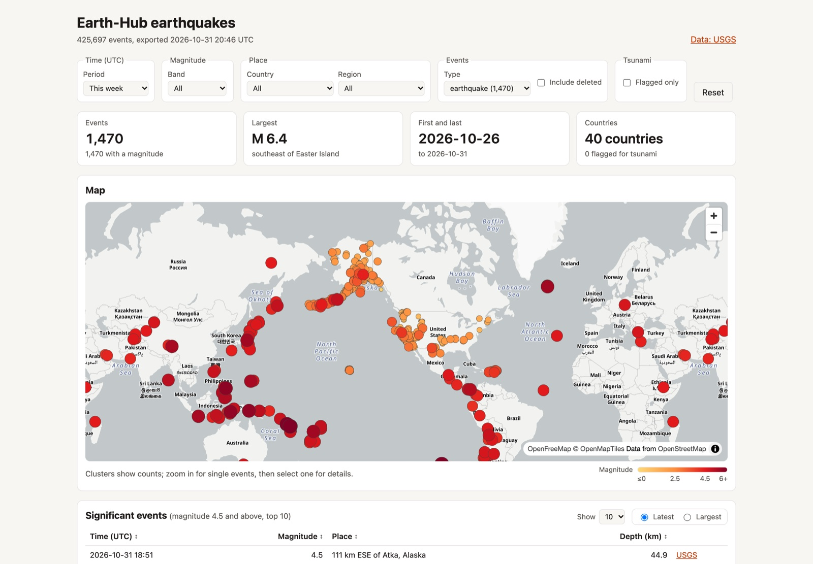
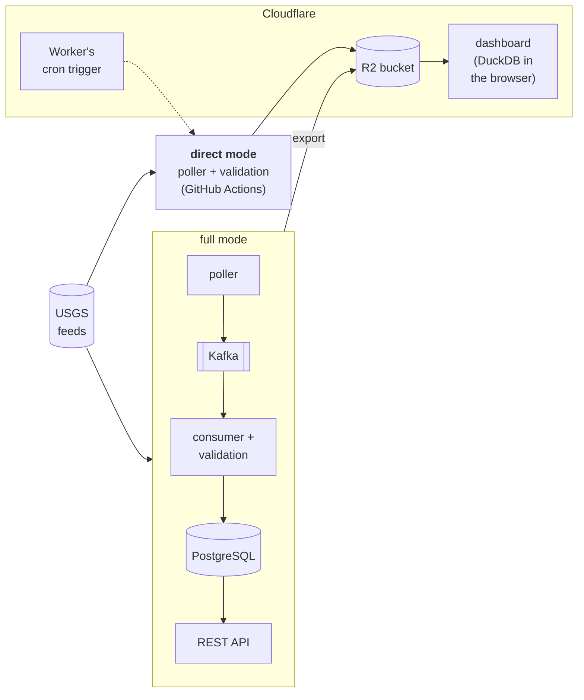

# Earth Hub

A local-first earthquake data platform, built as a QA engineering portfolio project. The live USGS feed flows through Apache Kafka into validated PostgreSQL tables; a read-only REST API serves them, and a public dashboard shows them from an export to Cloudflare R2. The point is less the pipeline than the evidence that it works: every requirement traces to a passing test, every defect is logged with how it was found and fixed, and CI runs the regression on every pull request.

**Status:** released as [v1.0.0](https://github.com/dienarvaez1/earth-hub/releases/tag/v1.0.0) on 2026-10-29; `main` is protected and accepts only changes that pass CI ([status](docs/progress/plan.md#status)). The dashboard runs at **https://earth-hub.diego-narvaez.workers.dev**, shared by link and kept out of search engines.

[](https://earth-hub.diego-narvaez.workers.dev)

*As it opens, with every default, on 2026-10-31.*

## For reviewers

| If you have | Start with |
| --- | --- |
| 2 minutes | [Quality at a glance](#quality-at-a-glance), then the [defect log](docs/progress/defects.md) |
| 10 minutes | The [demo walkthrough](docs/overview/demo.md): start it, run the tests, ingest the live feed, query the API, break something on purpose |
| An hour | The [architecture](docs/technical/architecture.md), the [test strategy](docs/progress/test-strategy.md), the [requirements](docs/progress/requirements.md) and their [traceability matrix](docs/progress/traceability-matrix.md), and [how Claude Code was used](#how-claude-code-was-used) |



Two modes write the same bucket, one at a time: **full** (the whole pipeline, on one machine) and **direct** (no Docker, Kafka or PostgreSQL, on GitHub Actions, so the dashboard stays current with no machine on). How they hand over is in the [architecture](docs/technical/architecture.md#switching-modes).

## Quality at a glance

| | |
| --- | --- |
| **Requirements** | 207 requirements, each with a stable ID and at least one passing test that names it (`@pytest.mark.req`); `make traceability` fails if one has none |
| **Tests** | About 1,200 in eight layers: unit, integration, API, contract (Schemathesis), end-to-end, dashboard (in Chromium), disruptive (real outages) and performance; about 92% coverage |
| **Defects** | 68 defects found and fixed, each with how it was found and the commit that fixed it; [the most instructive written up in full](docs/progress/defects.md) |
| **CI** | Lint, unit tests and the regression of every layer but performance on every pull request, with no secrets ([CI](docs/technical/ci.md)) |
| **Data integrity** | Kafka offsets committed only after the database, idempotent upserts, newest revision wins, and reconciliation of each topic with the database and of the data with USGS. At-least-once, never claimed exactly-once |
| **Recovery** | PostgreSQL stopped mid-stream, a Kafka restart, crashes between the two commits, restarts: each tested, each ending in a reconciliation |
| **Security** | Ruff's security and complexity rules, CodeQL, Dependabot and secret scanning, every finding triaged |
| **Privacy** | The dashboard collects nothing about its visitors ([privacy](#privacy)) |
| **Docs that can't drift** | The [API](docs/technical/api.md) and [SQL](docs/technical/sql-examples.md) examples are replayed by tests, the [schema](docs/technical/schema.md) is checked against the models, links are checked, and each changing fact has one home |

**Some things the testing found:**
- **A security leak:** the database password printed in test tracebacks (DEF-001).
- **A flaky network setup:** `localhost` resolving to IPv6 made Kafka offset lookups fail intermittently (DEF-004).
- **A false pass:** an outage check reported PASS while leaving a consumer running (DEF-008).
- **Contract defects from generated requests:** server errors and deviations from the documented contract that hand-written tests missed (DEF-013 to DEF-018).
- **A hidden earthquake:** a merged duplicate's deletion hid a real event, found by reconciling a backfill with USGS (DEF-026).

## Quick start

Needs Docker (with Compose, at least 4 GB of memory), [uv](https://docs.astral.sh/uv/) and GNU Make; Node.js 24 only for the dashboard. Kafka and PostgreSQL run in Docker, bound to `127.0.0.1`.

```bash
cp .env.example .env     # then change POSTGRES_PASSWORD
make install             # .venv from uv.lock (Python 3.13)
make up && make migrate  # Kafka and PostgreSQL, the topics and the schema
make test                # unit tests: no Docker or network needed
make ingest              # the pipeline on the live USGS feed
make api                 # the REST API at http://127.0.0.1:8000/docs
```

`make help` lists every command; the [cheat sheet](docs/overview/cheatsheet.md) groups them by part, next to the Claude Code skill that runs each. The [demo walkthrough](docs/overview/demo.md) goes through the commands above with what to look for, and [deployment](docs/technical/deployment.md) covers setting up a machine and moving full mode between machines.

## What is in it

| Part | What it does | More |
| --- | --- | --- |
| **Ingestion** | The poller reads the USGS feed every minute and publishes new and revised events to Kafka; catch-up and backfill bring revisions, deletions and history | [Architecture](docs/technical/architecture.md#ingestion) |
| **Persistence** | The consumer validates each message against the [data-quality rules](docs/technical/data-quality-rules.md), merges what USGS turns out to be one event, and keeps every message with its outcome | [Schema](docs/technical/schema.md) |
| **REST API** | Read-only, over PostgreSQL: events, lookups by any former ID, statistics and summaries | [API reference](docs/technical/api.md) |
| **Export** | Copies the table to R2, uploading only what changed, and writes a Parquet snapshot | [Architecture](docs/technical/architecture.md#export-to-r2) |
| **Direct mode** | The same poller and catch-up straight to R2, giving the bucket full mode's export would, byte for byte | [Architecture](docs/technical/architecture.md#direct-mode) |
| **Dashboard** | A Cloudflare Worker serves the page and the snapshot; the browser runs the reports with DuckDB-WASM and draws the map and charts | [Architecture](docs/technical/architecture.md#dashboard), [SQL](docs/technical/sql-examples.md#dashboard-reports) |
| **Observability** | JSON logs with a `stage` on every pipeline line and an `event_id` on every line about an event | [Observability](docs/technical/architecture.md#observability) |

## Tests and QA

`make regression` runs every layer in order (lint, unit, integration, API, contract, end-to-end, dashboard, disruptive, performance), then the traceability check, and writes its reports to `reports/`. What each layer covers, and why, is in the [test strategy](docs/progress/test-strategy.md); the other QA documents are the [requirements](docs/progress/requirements.md) and their [traceability matrix](docs/progress/traceability-matrix.md), the [defect log](docs/progress/defects.md), the [data-quality rules](docs/technical/data-quality-rules.md) and the [known limitations](docs/overview/limitations.md).

## How Claude Code was used

Earth-Hub was built with [Claude Code](https://claude.com/claude-code), Anthropic's coding agent, inside fixed quality gates. Claude Code wrote the code, tests and documents; the author decided what was built and what counts as done.

**The working method**, in the [implementation plan](docs/progress/plan.md#7-claude-code-development-workflow) and in [`CLAUDE.md`](CLAUDE.md), the rules Claude Code reads in every session:
1. **Plan.** Before each milestone, Claude Code proposes the changes, the test strategy and the acceptance criteria, and waits for approval.
2. **Implement.** It writes the change, with tests that name the requirements they verify.
3. **Verify.** It runs the real suites and reports the actual results, failures included.
4. **Review.** The author reads the pull request; Claude Code merges or deploys only when asked.

When a defect showed a class of mistake, a rule went into `CLAUDE.md` so it would not recur: never use `localhost` for Kafka (DEF-004), never compare `updated` times outside `revisions.py` (DEF-026), state a fact in one place (DEF-068).

**Decisions that stayed with the author:** scope and order (the milestone plan, each proposal approved, revised or narrowed); what counts as done (every layer green, every requirement traced, the end-to-end suite passing 5 runs out of 5); risk and exposure (everything bound to `127.0.0.1`, R2 secrets in one workflow only, the dashboard public by link but out of search engines); and every merge, deploy and live operation.

**Skills for operating it.** The everyday operations are Claude Code skills in `.claude/skills/` (`/eh-status`, `/eh-mode`, `/eh-db`, …), indexed in the [cheat sheet](docs/overview/cheatsheet.md); a test checks that every skill and command the docs name exists.

**Not trusting AI-written tests either.** The [test strategy](docs/progress/test-strategy.md#ai-assisted-development) applies mutation spot checks, repeated runs, independent oracles and tests of the test tooling. Some defects were in the test tooling itself (DEF-007, DEF-008, DEF-025, DEF-028, DEF-029), found because results were checked rather than trusted. Those found after merge (DEF-034 to DEF-039, DEF-053 to DEF-068) are logged as such.

## Documentation

In three groups under `docs/`, indexed in [docs/README.md](docs/README.md): **overview** (demo, cheat sheet, limitations), **technical** (architecture, deployment, schema, API, SQL, data-quality rules, CI) and **progress** (plan and status, requirements, traceability matrix, test strategy, defect log).

## Troubleshooting

- **Port already in use:** change `POSTGRES_PORT` in `.env`, or stop whatever uses 29092.
- **Kafka connection errors mentioning `::1`:** use `127.0.0.1:29092`, not `localhost:29092`; the port is published on IPv4 only.
- **Kafka slow to become healthy:** the first start takes 15–30 seconds; `make up` waits for it.
- **Start over with empty data:** `make reset && make up && make migrate`.
- **`make reconcile` reports lost messages:** a message was acknowledged without a `raw_events` row. Check the consumer logs for that partition and offset; replaying it is safe, because redelivery is idempotent.

## Data source and disclaimer

Earthquake data courtesy of the [U.S. Geological Survey](https://earthquake.usgs.gov/) (USGS) Earthquake Hazards Program, from its public GeoJSON feeds and FDSN event service. USGS data is in the public domain; Earth-Hub credits USGS as its source, as USGS asks.

- **Independent, for research purposes.** Earth-Hub is not affiliated with or endorsed by USGS, and it is not a complete or exact copy of the USGS service.
- **The data may be late, incomplete or inaccurate.** USGS revises and deletes events after publishing them, and Earth-Hub follows with a delay ([limitations](docs/overview/limitations.md#freshness)). If any part of the system fails, events can be missing, out of date or wrong until it recovers.
- **Some fields are Earth-Hub's own.** City, region and country are derived from USGS's place text ([`validation/places.py`](src/earth_hub/validation/places.py)), and the dashboard's rankings and charts are Earth-Hub's summaries.
- **Not for emergency or safety decisions.** For current earthquakes and alerts, use [USGS's own map](https://earthquake.usgs.gov/earthquakes/map/) and official warnings.
- **No warranty.** The software and the data it shows are provided as is, without warranty of any kind ([MIT License](LICENSE)).

The dashboard repeats this in its footer, beside the map credits (© OpenFreeMap, © OpenMapTiles, data © OpenStreetMap contributors).

## Privacy

The dashboard collects nothing about its visitors ([privacy notice](dashboard/public/privacy.html), at `/privacy` on the page): no cookies, nothing in the browser's storage, no accounts, analytics or tracking, and never the device's location. The Worker keeps no request logs, which would record visitors' IP addresses. Cloudflare, which hosts it, and the two content providers the page loads from (jsDelivr for the DuckDB engine, OpenFreeMap for the map tiles) receive visitors' IP addresses as part of delivering content, under their own privacy policies.

## License

Earth-Hub is released under the [MIT License](LICENSE). The dashboard's bundled packages keep their own licenses, listed in `dist/third-party-licenses.txt` when it is built.
