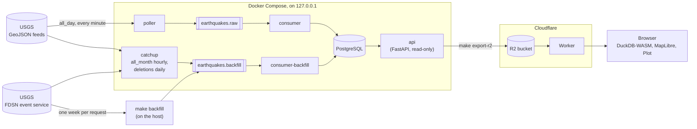
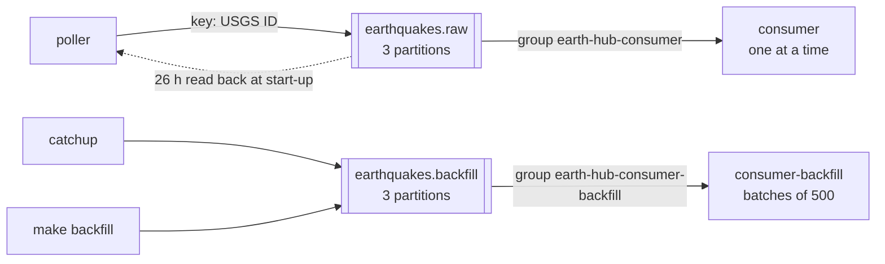
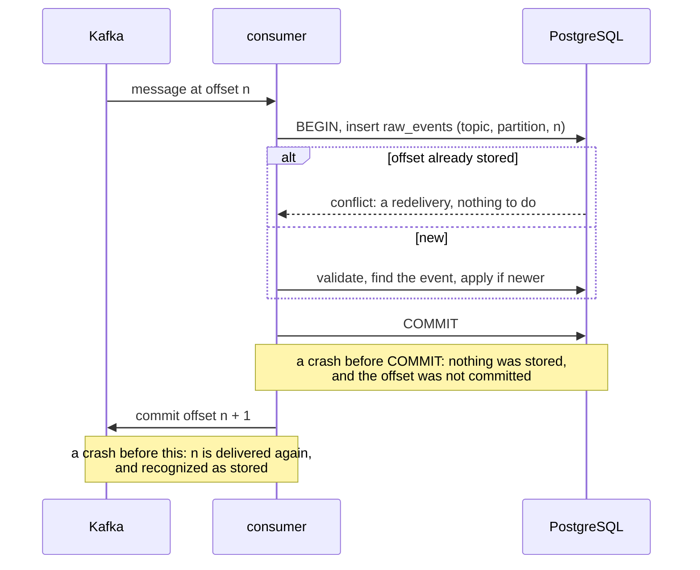
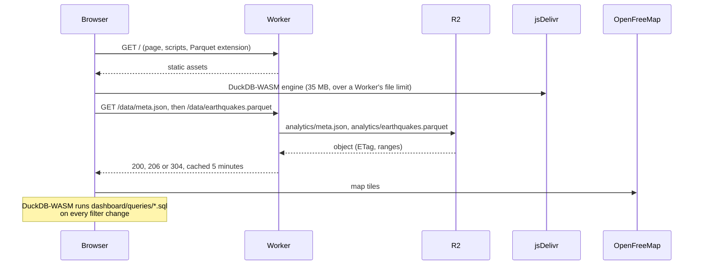

# Architecture

How Earth-Hub is put together: what each part does, what it may read and write, and how it recovers. The tables are in [the schema](schema.md), the endpoints in [the API reference](api.md), and the log fields in [observability](observability.md).

## Overview



Each arrow is the only way data moves between those two parts:

- **USGS is read only by ingestion** (the poller, catch-up and backfill), never by the API or the tests. Unit tests can't reach the network at all.
- **Kafka carries the unchanged USGS feature** in a versioned envelope. Only the consumer interprets it.
- **PostgreSQL is written only by the consumers**, apart from backfill's progress table and catch-up's checkpoint.
- **The API only reads PostgreSQL:** never Kafka or USGS.
- **The exporter reads only the API** (`GET /api/v1/export/earthquakes`), never PostgreSQL. It runs on demand, never on a schedule.
- **The Worker exposes two files of the bucket** (the Parquet snapshot and its `meta.json`) and nothing else. The browser runs every report itself.

## Services

`make up` starts only the infrastructure, so tests never depend on live data. `make ingest` adds the pipeline, and `make api` adds the API.

| Service | Started by | Does | Health check |
| --- | --- | --- | --- |
| `kafka` | `make up` | Apache Kafka 4.2 in KRaft mode, one broker (`apache/kafka:4.2.2`) | broker API answers |
| `kafka-init` | `make up` | Creates both topics, 3 partitions each, then exits | |
| `postgres` | `make up` | PostgreSQL 18 (`postgres:18.6`) | `pg_isready` |
| `migrate` | `make ingest` | `alembic upgrade head`, then exits | |
| `poller` | `make ingest` | Live feed → `earthquakes.raw` | a successful round within 3 poll intervals |
| `consumer` | `make ingest` | `earthquakes.raw` → PostgreSQL, one message at a time | heartbeat |
| `consumer-backfill` | `make ingest` | `earthquakes.backfill` → PostgreSQL, in batches of up to `CONSUMER_BATCH_SIZE` (500) | heartbeat |
| `catchup` | `make ingest` | `all_month` hourly and deleted events daily → `earthquakes.backfill` | heartbeat |
| `api` | `make api` | The REST API on port 8000 | `/api/v1/health` |
| `kafka-ui` | `make kafka-ui` | A read-only web viewer for the topics, on port 8080 | |

All ports are bound to `127.0.0.1`. Kafka uses `PLAINTEXT` and JMX has no authentication, which is acceptable only because nothing outside the machine can reach them.

| From your machine | Address |
| --- | --- |
| Kafka | `127.0.0.1:29092` (IPv4 only: `localhost` can resolve to `::1`, which flaked offset lookups, DEF-004) |
| Kafka JMX | `127.0.0.1:9101`, e.g. `jconsole 127.0.0.1:9101`, *Insecure connection* |
| PostgreSQL | `localhost:5433` (5432 is often taken by a local PostgreSQL) |
| API | `http://127.0.0.1:8000/docs` |
| Kafka UI | `http://127.0.0.1:8080`: [Kafbat UI](https://github.com/kafbat/kafka-ui) `v1.5.0`, read-only, so producing or deleting is refused (`405`) |
| Dashboard (local) | `http://127.0.0.1:8787` (`make dashboard-dev`) |

## Topics and consumer groups



- **Messages are keyed by USGS event ID,** so every revision of an event goes to one partition, in order.
- **Two topics,** so that a year of history never queues in front of live events. The poller reads `earthquakes.raw` back at start-up, to know what it already sent; it never reads the backfill topic.
- **Both consumers run the same code,** with two settings apart. `consumer-backfill` sets `KAFKA_CONSUMER_TOPIC`, and takes up to `CONSUMER_BATCH_SIZE` messages at once, processed as a set (`process_batch`). The live consumer has a batch size of 1 (`process_message`), so the outcome of every live event is logged (DEF-036). `tests/integration/test_batch.py` checks, on random streams, that a batch gives exactly the results of handling its messages one at a time.

**The envelope** (`schema_version` 1) has these fields: `event_id`, `ids`, `source_updated_ms`, `event_time_ms`, `source`, `feed_generated_ms`, `fetched_at`, and `payload`, which is the USGS feature, unchanged. The poller drops only features it can't route: those without a usable `id`, `updated` or `time`. Every data-quality rule is applied by the consumer, which keeps rejected messages.

## Ingestion

The poller (`src/earth_hub/ingestion/`) fetches the USGS `all_day` feed and publishes each new or revised event to `earthquakes.raw`.

- **Timing:** the feed is regenerated every minute. The poller sends `If-Modified-Since`, then waits until just after the feed's `Expires` time: 2–5 s of jitter, between 10 s and 5 min. It falls back to `POLL_INTERVAL_SECONDS` without the header. Events reach Kafka 1–2 minutes after USGS publishes them.
- **Only changes are sent:** an event is published when it is new, or its `updated` time moved forward. It counts as sent only once Kafka confirms delivery, and a failed delivery is retried the next round. The poller never records `Last-Modified` after a failed delivery, so the next request can't come back `304` and lose those events (DEF-005).
- **Restarts:** at start-up the poller rebuilds what it has sent from the last 26 hours of `earthquakes.raw`, so a restart resends nothing.
- **Errors:** timeouts, connection errors, `429` and `5xx` are retried up to 3 times with backoff; other `4xx` are not. A failed round sends nothing and is retried at the fallback interval.
- **`USGS_CONTACT`** in `.env` adds a contact to the `User-Agent` sent to USGS.

## Backfill and catch-up

```bash
make backfill START=2026-01-01            # 2026 up to now, one request per week
make backfill START=2026-01-01 END=2026-06-01
make catchup-once                         # one all_month pass and one deleted-events check
```

- **Backfill** reads the USGS FDSN event service one calendar week per request, Sunday 00:00:00 UTC to the next Sunday. Each window ends exactly where the next begins, because FDSN ignores milliseconds in query times: a window "ending at 23:59:59.999" would lose events.
- **Every week is checked** against FDSN's `/count`, with the same `includedeleted`, and is recorded in `backfill_windows` only when complete. A re-run skips finished weeks.
- **Deleted and other events are queried separately.** Asking for both at once was 20 to 100 times slower, and returned some real events as stubs (DEF-021).
- **Weeks are split into days** when USGS times out on them, or when they hold more than 20,000 events. A `504` is not retried: the gateway caches it.
- **A final sweep** picks up events that USGS added or revised while the backfill ran.
- **Requests go one at a time,** with a 1-second pause between them.
- **The `catchup` service** reads the `all_month` feed hourly, which covers revisions and outages of up to 30 days, and checks FDSN daily for deleted events.
- **Both publish to `earthquakes.backfill`,** and only events that are new or newer than what is stored. A year of history (139,579 events) goes through in about 42 seconds.

## Persistence

How a message changes the tables, one transaction per message, is in [the schema](schema.md#how-a-message-changes-the-tables). The guarantees:

- **At-least-once delivery, idempotent effect.** The Kafka offset is committed only after the database transaction. A redelivered message is recognized by its topic, partition and offset, and a re-sent revision by its `updated` time. Earth-Hub does not claim exactly-once processing.
- **Newer wins, always through one function.** Whether a revision replaces the stored one is decided only by `database/revisions.py:compare`. The consumer's two paths and backfill's "does this need publishing" all use it.
- **Bad data is kept, not stored as an event.** 16 [data-quality rules](data-quality-rules.md) with stable IDs, plus `CHECK` constraints in the database as a second line of defense.
- **`make reconcile`** compares each topic with `raw_events`. A missing row below the group's committed offset is **lost**; at or above it, it is **pending** (lag). It also checks five invariants, such as every preferred ID mapping to its own event.

## Recovery



| Failure | What happens | Tested by |
| --- | --- | --- |
| PostgreSQL down | The consumer retries the same message with backoff (up to 30 s) until it's back, never rejecting the message because of it, and its health check fails meanwhile. The API answers `503`, but still `422` for invalid requests | `tests/disruptive/test_outages.py`, `make check-db-outage` |
| Kafka restarted | The poller and consumers reconnect; nothing is lost or duplicated | `tests/disruptive/test_outages.py` |
| Consumer killed mid-stream | Uncommitted offsets are delivered again and recognized | `tests/e2e/test_scenarios.py`, `tests/integration/test_pipeline.py` |
| Poller restarted | It rebuilds what it sent from the topic, and resends nothing | `tests/e2e/test_scenarios.py`, `tests/integration/test_ingestion.py` |
| A message that keeps failing | After 3 attempts for a reason other than the database, it's stored with `outcome = 'error'`, so one bad message can't stall a partition | `tests/unit/test_consumer.py` |
| An outage longer than the live feed's day | Catch-up's hourly `all_month` pass covers up to 30 days; beyond that, `make backfill` | `tests/e2e/test_backfill.py` |
| Both services restarted | The data survives | `tests/disruptive/test_outages.py`, `make smoke-restart` |
| An export interrupted | The next run carries on from its last checkpoint; objects are named by primary key, so they are never duplicated | `tests/unit/test_export_r2.py` |

## Export to R2

`make export-r2` copies the `earthquakes` table to a Cloudflare R2 bucket, and only on demand. It reads through the API, so the API must be running (`make api`). Set `R2_ACCOUNT_ID`, `R2_ACCESS_KEY_ID`, `R2_SECRET_ACCESS_KEY` and `R2_BUCKET` in `.env`, from an R2 API token with Object Read & Write on the bucket.

| In the bucket | What it is |
| --- | --- |
| `earthquakes/<id>.json` | One object per row, every column |
| `_state/earthquakes-manifest.json.gz` | SHA-256 of each row as last uploaded |
| `_state/lock.json` | Held while a run is in progress (expires after 2 hours if a run crashes) |
| `runs/<run_id>.json` | One record per run: status, counts, timings, errors (also in `reports/exports/`) |
| `analytics/earthquakes.parquet` | The whole table in one Parquet file for the dashboard, every row and column with types kept (about 7.5 MB for 115,000 rows) |
| `analytics/meta.json` | What the snapshot holds: run, row count, size, SHA-256, column types |

**What a run does:**
- **Uploads only what changed.** A run uploads new or changed rows and skips unchanged ones. It deletes the objects of rows that left the table, which are merged events.
- **Never duplicates.** Each row is one object named by its primary key, so reruns and interrupted runs can't create duplicates. A failed upload is retried by the next run.
- **Saves progress every 10 pages** (10,000 rows), so a run carries on after an interruption.
- **Trusts the manifest by default** to say what the bucket holds, so a run with a few changes takes about 15 s.
- **`VERIFY=1` also lists the bucket** (about 100 s for 115,000 objects), to:
  - delete objects the manifest doesn't know;
  - upload again any removed by hand;
  - check the result against the bucket itself.

  A run without a readable manifest always does this.
- **Succeeds only** when the bucket then holds exactly the rows the run read.
- **Rewrites the Parquet snapshot** after it succeeds, if rows changed. The snapshot is built from the same rows, so it holds exactly what the bucket does; a dry run or a failed run never writes it.
- **Sets `EXPORT_WORKERS`** (default 64), the number of uploads at once. A first full export of about 115,000 rows took 98 minutes at 16.

```bash
make export-r2 DRY_RUN=1   # what would change, writing nothing
make export-r2             # e.g. read 114731  new 0  updated 12  unchanged 114719  deleted 1  failed 0
make export-r2-runs        # past runs; one that never finished shows as interrupted
```

## Dashboard

A public page with an interactive map and charts of every stored earthquake, built only from the R2 export. A Cloudflare Worker on the free plan serves it at `https://earth-hub.<your-subdomain>.workers.dev`.



| Part | What it does |
| --- | --- |
| `dashboard/src/worker.ts` | Serves `/data/earthquakes.parquet` and `/data/meta.json` from the bucket through an R2 binding, with `ETag`, `304`, byte ranges and a 5-minute browser cache. Nothing else in the bucket is reachable, and the page holds no credentials |
| `dashboard/index.html`, `dashboard/src/` | The page. DuckDB-WASM runs `dashboard/queries/*.sql` over the snapshot in the browser; MapLibre GL draws the map on OpenFreeMap tiles; Observable Plot draws the charts |
| `dashboard/queries/` | The reports, as SQL files; see [the SQL examples](sql-examples.md#dashboard-reports) |
| `scripts/fetch_duckdb_extensions.py` | Downloads DuckDB's Parquet extension (pinned by SHA-256), so the page serves it itself |
| `scripts/dashboard_config.py` | Writes `dashboard/wrangler.jsonc` with the bucket from `R2_BUCKET` (generated, never committed) |
| `vite.config.ts` | Builds the page, and writes `third-party-licenses.txt` from the bundled packages (DEF-035) |

```bash
make dashboard-install   # once: npm ci and the test browser
make dashboard-dev       # http://127.0.0.1:8787, over the real bucket (read-only)
npx wrangler login       # once, before the first deploy
make dashboard-deploy    # publish; prints the workers.dev address
```

- **Time presets:** Today (the default), This week (from Monday), This month, Last 3 months, This year, Last 3 years, and Custom with From and To calendars. Every period is whole UTC days through today, and each preset picks a chart grouping: per day, week or month.
- **The map** shows every event as its own point, up to 5,000 events. Above that it clusters them, except events of magnitude 6 or more, which always stay single points on top.
- **Until the release, the page is a preview.** It's marked "Preview — in development" and asks search engines not to index it: `X-Robots-Tag: noindex` on every response, a `robots` meta tag, and a disallow-all `robots.txt`.

**Measured** (`reports/dashboard-performance.json`): medians of five cold runs in headless Chromium on a developer machine, with the data served locally.

| Rows | Snapshot | First map (Today) | All events (Last 3 years) | Filter change |
| --- | --- | --- | --- | --- |
| 115,000 | 6.0 MB | about 4 s | about 0.5 s | about 140 ms |
| 1,000,000 | 36 MB | about 4.5 s | about 3.7 s | about 900 ms |

About 3–4 s of the first map is the browser compiling DuckDB's engine. Browsers cache that between visits, which the tests don't measure.

## Observability

Every service logs JSON lines.
- **Every pipeline line has a `stage`:** `fetch`, `parse`, `publish` or `persist`.
- **Every line about one event has its `event_id`,** so one event can be followed from the feed to the database.
- **The consumer logs a summary every minute,** with its outcome counts and its lag behind Kafka.

[Observability](observability.md) has the fields and `jq` recipes, plus a controlled failure diagnosed from the logs alone (also an end-to-end test).

```bash
docker compose logs --no-log-prefix poller consumer | jq -cR 'fromjson? | select(.event_id == "us7000abcd")'
docker compose logs --no-log-prefix consumer | jq -cR 'fromjson? | select(.message == "consumer summary") | {ts, lag, outcomes}'
```

## Configuration

Settings come from environment variables or `.env` (see `.env.example`), and `src/earth_hub/config.py` validates them at startup.
- **`.env` holds values for code running on your machine.** Containers get their in-network host names (`postgres:5432`, `kafka:9092`) from `docker-compose.yml`.
- **`.env` is git-ignored** and must never be committed.
- **Passwords never appear** in logs, test output or API responses (DEF-001).
