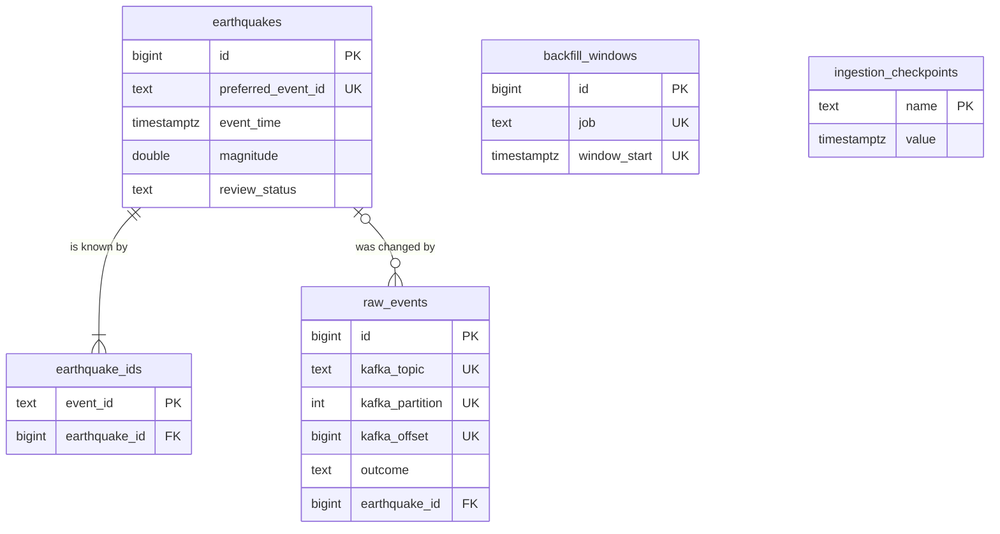

# Database schema

PostgreSQL 18, defined in `src/earth_hub/database/models.py` and created by the Alembic migrations in `migrations/versions/` (`make migrate`). `tests/integration/test_migrations.py` fails if the migrations and the models differ, and `tests/unit/test_schema_doc.py` fails if this page leaves out a column or gets its type or nullability wrong. Every time is a UTC `timestamptz`.

| Table | Holds | Written by |
| --- | --- | --- |
| [`earthquakes`](#earthquakes) | One row per physical event, as of its newest applied revision | the consumers |
| [`earthquake_ids`](#earthquake_ids) | Every USGS ID ever seen, mapped to its event | the consumers |
| [`raw_events`](#raw_events) | Every Kafka message received, with what happened to it | the consumers |
| [`backfill_windows`](#backfill_windows) | Each finished time window of a backfill, so a re-run resumes | backfill |
| [`ingestion_checkpoints`](#ingestion_checkpoints) | Named points in time; today, how far the deleted-events check has looked | catch-up |

## How a message changes the tables

The consumer handles each message in one transaction (`repository.process_message`; the backfill consumer's batches go through `process_batch`, one transaction per batch, with the same results):

1. **`raw_events` first.** The row is inserted with its topic, partition and offset; if that offset is already there, the message is a redelivery and nothing else happens.
2. **Validation.** A message that breaks a [data-quality rule](data-quality-rules.md) is kept in `raw_events` as `rejected`, with the rule's ID, and goes no further.
3. **Finding the event** through any of the message's IDs in `earthquake_ids`. If its IDs point to two stored events, those are merged: IDs and `raw_events` rows move to the oldest row, which takes the newest revision's data, and the others are deleted.
4. **The revision rule** (`database/revisions.py`): a newer `updated` replaces the stored revision (`applied`); the same one is a `duplicate`, an older one `stale`. A duplicate's deletion never hides the event that absorbed it (DEF-026).
5. **Commit**, and only then the Kafka offset.

Advisory locks on each USGS ID, taken in sorted order, keep two consumers from creating or merging the same event at once. [The SQL examples](sql-examples.md#inspecting-postgresql) show queries over these tables and their results.

## Tables

### earthquakes

One row per physical event, whatever USGS IDs it has had. Deleted events stay, with `review_status = 'deleted'`.

| Column | Type | Null | Meaning |
| --- | --- | --- | --- |
| `id` | bigint | no | Primary key (identity). Stable while the row exists; the R2 export names objects by it |
| `preferred_event_id` | text | no | USGS's current preferred ID. Unique |
| `event_time` | timestamptz | no | When the event happened |
| `event_time_ms` | bigint | no | The same, in milliseconds since 1970, as USGS sends it |
| `source_updated` | timestamptz | no | When USGS last revised it |
| `source_updated_ms` | bigint | no | The same, in milliseconds; compared to decide whether a revision is newer |
| `magnitude` | double precision | yes | −2 to 10.5 |
| `mag_type` | text | yes | Magnitude scale, e.g. `ml`, `mb`, `mww` |
| `place` | text | yes | USGS's place text, unchanged |
| `city` | text | yes | Derived from `place` (`validation/places.py`) |
| `region` | text | yes | Derived from `place`: a US state, or an area |
| `country` | text | yes | Derived from `place`; US states give `United States` |
| `longitude` | double precision | no | −180 to 180 |
| `latitude` | double precision | no | −90 to 90 |
| `depth_km` | double precision | no | −10 to 1,000; negative is above sea level |
| `event_type` | text | no | `earthquake`, `explosion`, `quarry blast`, … |
| `review_status` | text | no | `automatic`, `reviewed` or `deleted` |
| `tsunami` | boolean | no | USGS's tsunami flag |
| `felt` | integer | yes | Number of "Did You Feel It?" reports |
| `cdi` | double precision | yes | Maximum reported intensity |
| `mmi` | double precision | yes | Maximum estimated instrumental intensity |
| `alert` | text | yes | PAGER alert level |
| `sig` | integer | yes | USGS significance, 0 to about 1,000 |
| `net` | text | yes | Contributing network |
| `url` | text | yes | The USGS event page |
| `title` | text | yes | USGS's title |
| `revision_ids` | text[] | no | The IDs listed by the stored revision; used to tell a duplicate's deletion from the event's (default `{}`) |
| `revision_count` | integer | no | Revisions applied, at least 1 (default 1) |
| `first_seen_at` | timestamptz | no | When Earth-Hub first stored it (default `now()`) |
| `last_applied_at` | timestamptz | no | When Earth-Hub last changed it (default `now()`) |

**Constraints:** the ranges above as `CHECK`s, the same limits as the validation rules, enforced a second time by the database; `review_status` in its three values; `source_updated_ms >= event_time_ms`; `revision_count >= 1`. **Indexes:** `event_time`, `magnitude`.

### earthquake_ids

Every USGS ID ever seen. When USGS changes an event's preferred ID, or finds that two reports are one quake, the old IDs stay here, so a lookup by any of them finds the event.

| Column | Type | Null | Meaning |
| --- | --- | --- | --- |
| `event_id` | text | no | A USGS ID. Primary key |
| `earthquake_id` | bigint | no | The event: `earthquakes.id` |
| `first_seen_at` | timestamptz | no | When the ID was first seen (default `now()`) |

The foreign key has no `ON DELETE CASCADE`: a merge must move the IDs explicitly, so a bug fails loudly instead of losing them. **Index:** `earthquake_id`.

### raw_events

Every Kafka message received, rejected ones included, so any stored value can be traced to the message it came from and `make reconcile` can compare the topic with the database.

| Column | Type | Null | Meaning |
| --- | --- | --- | --- |
| `id` | bigint | no | Primary key (identity), in order of arrival |
| `kafka_topic` | text | no | `earthquakes.raw` or `earthquakes.backfill` |
| `kafka_partition` | integer | no | |
| `kafka_offset` | bigint | no | Unique with topic and partition: a redelivered message is recognized |
| `kafka_timestamp` | timestamptz | yes | The message's Kafka timestamp |
| `message_key` | text | yes | The USGS ID the poller keyed it by |
| `envelope` | jsonb | yes | The whole message, the unchanged USGS feature inside |
| `raw_value` | text | yes | Only when the value could not be stored as JSON |
| `event_id` | text | yes | The envelope's event ID, when it has one |
| `source_updated_ms` | bigint | yes | The envelope's `updated` time |
| `outcome` | text | no | `applied`, `duplicate`, `stale`, `rejected` or `error` |
| `rule` | text | yes | The data-quality rule a rejected message broke, e.g. `GEO-002` |
| `reason` | text | yes | Why, for `rejected`, `error`, and outcomes the times alone would not explain |
| `earthquake_id` | bigint | yes | The event it touched, if any: `earthquakes.id` |
| `received_at` | timestamptz | no | When the consumer stored it (default `now()`) |

**Indexes:** `outcome`, `earthquake_id`, `event_id`.

### backfill_windows

One row per finished window of `make backfill` (job `backfill`) and of its final sweep (job `sweep`). A re-run skips windows marked `done`.

| Column | Type | Null | Meaning |
| --- | --- | --- | --- |
| `id` | bigint | no | Primary key (identity) |
| `job` | text | no | `backfill` or `sweep` |
| `window_start` | timestamptz | no | Inclusive. Unique with `job` |
| `window_end` | timestamptz | no | Exclusive: exactly where the next window starts |
| `status` | text | no | `done`, or `open` when the window ended at "now" and is fetched again next run |
| `expected` | integer | no | What FDSN's `/count` reported |
| `fetched` | integer | no | Events fetched; never fewer than `expected` |
| `published` | integer | no | Published to `earthquakes.backfill`: new, or newer than stored |
| `skipped` | integer | no | Already stored at this revision or a newer one |
| `rejected` | integer | no | Without a usable ID or time |
| `finished_at` | timestamptz | no | Default `now()` |

### ingestion_checkpoints

| Column | Type | Null | Meaning |
| --- | --- | --- | --- |
| `name` | text | no | Primary key: `deleted`, the daily deleted-events check of catch-up |
| `value` | timestamptz | no | When that check last started; the next one asks FDSN for deletions since then |
| `updated_at` | timestamptz | no | Default `now()` |
