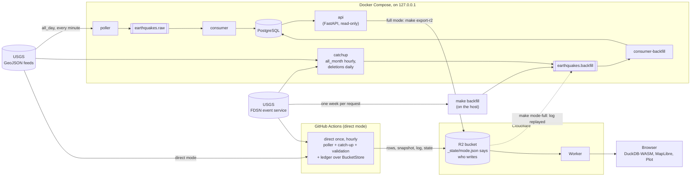
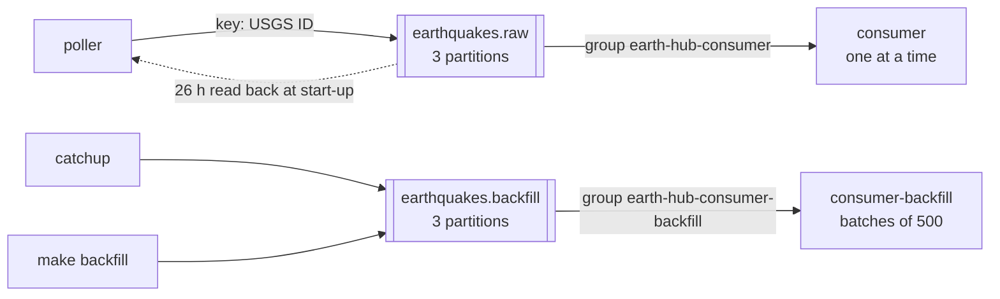
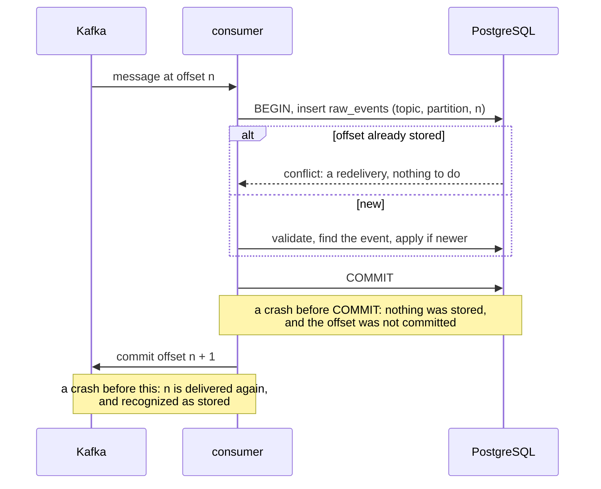
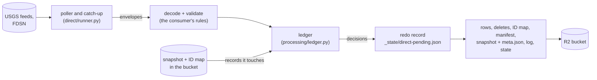
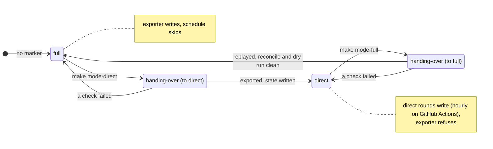
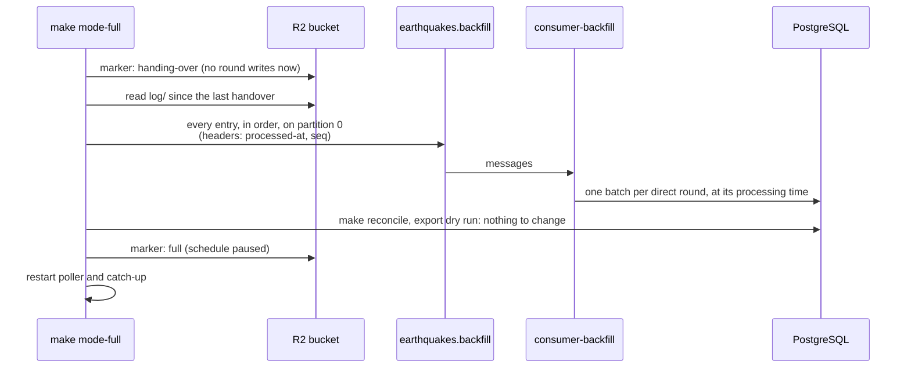
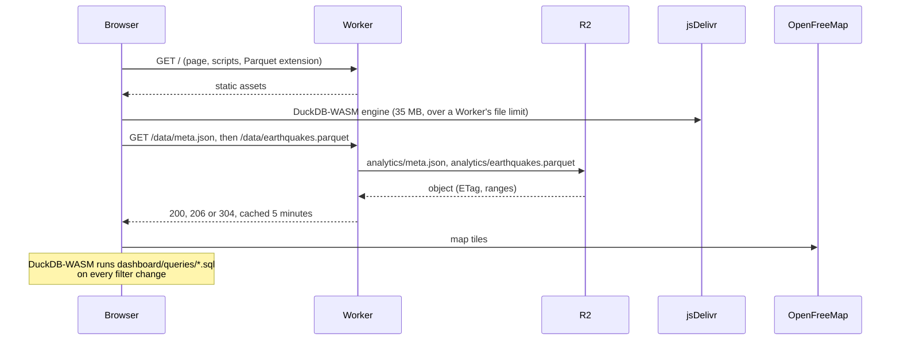

# Architecture

How Earth-Hub is put together: what each part does, what it may read and write, and how it recovers. The tables are in [the schema](schema.md), the endpoints in [the API reference](api.md), and the log fields in [Observability](#observability).

## Overview



Each arrow is the only way data moves between those two parts:

- **USGS is read only by ingestion** (the poller, catch-up and backfill), never by the API or the tests. Unit tests can't reach the network at all.
- **Kafka carries the unchanged USGS feature** in a versioned envelope. Only the consumer interprets it.
- **PostgreSQL is written only by the consumers**, apart from backfill's progress table and catch-up's checkpoint.
- **The API only reads PostgreSQL:** never Kafka or USGS.
- **The exporter reads only the API** (`GET /api/v1/export/earthquakes`), never PostgreSQL. It runs on demand, never on a schedule.
- **One mode writes the bucket at a time** ([switching modes](#switching-modes)): in full mode the exporter, in [direct mode](#direct-mode) the direct rounds, run hourly by GitHub Actions or by hand. The only path from the bucket back into Kafka is the handover to full mode, which replays direct mode's log onto `earthquakes.backfill`.
- **The Worker exposes two files of the bucket** (the Parquet snapshot and its `meta.json`) and nothing else. The browser runs every report itself.

## Services

`make up` starts only the infrastructure, so tests never depend on live data. `make ingest` adds the pipeline, and `make api` adds the API. With Claude Code: `/eh-start [infra|pipeline|api|ui|dashboard]`, `/eh-stop`, and `/eh-status` for the health of all of them. These are full mode's services: in direct mode the poller and catch-up stay stopped, and none of them is needed (`/eh-mode`).

| Service | Started by | Does | Health check |
| --- | --- | --- | --- |
| `kafka` | `make up` | Apache Kafka 4.2 in KRaft mode, one broker (`apache/kafka:4.2.2`) | broker API answers |
| `kafka-init` | `make up` | Creates both topics, 3 partitions each, then exits | |
| `postgres` | `make up` | PostgreSQL 18 (`postgres:18.6`) | `pg_isready` |
| `migrate` | `make ingest` | `alembic upgrade head`, then exits | |
| `poller` | `make ingest` | Live feed → `earthquakes.raw` | a successful round within 3 poll intervals |
| `consumer` | `make ingest` | `earthquakes.raw` → PostgreSQL, one message at a time | heartbeat |
| `consumer-backfill` | `make ingest` | `earthquakes.backfill` → PostgreSQL, in batches of up to `CONSUMER_BATCH_SIZE` (500) | heartbeat |
| `catchup` | `make ingest` | `all_month` hourly and deleted events daily → `earthquakes.backfill` | heartbeat |
| `api` | `make api` | The REST API on port 8000 | `/api/v1/health` |
| `kafka-ui` | `make kafka-ui` | A read-only web viewer for the topics, on port 8080 | |

All ports are bound to `127.0.0.1`. Kafka uses `PLAINTEXT` and JMX has no authentication, which is acceptable only because nothing outside the machine can reach them.

| From your machine | Address |
| --- | --- |
| Kafka | `127.0.0.1:29092` (IPv4 only: `localhost` can resolve to `::1`, which flaked offset lookups, DEF-004) |
| Kafka JMX | `127.0.0.1:9101`, e.g. `jconsole 127.0.0.1:9101`, *Insecure connection* |
| PostgreSQL | `localhost:5433` (5432 is often taken by a local PostgreSQL) |
| API | `http://127.0.0.1:8000/docs` |
| Kafka UI | `http://127.0.0.1:8080`: [Kafbat UI](https://github.com/kafbat/kafka-ui) `v1.5.0`, read-only, so producing or deleting is refused (`405`) |
| Dashboard (local) | `http://127.0.0.1:8787` (`make dashboard-dev`) |

## Topics and consumer groups



- **Messages are keyed by USGS event ID,** so every revision of an event goes to one partition, in order.
- **Two topics,** so that a year of history never queues in front of live events. The poller reads `earthquakes.raw` back at start-up, to know what it already sent; it never reads the backfill topic.
- **Both consumers run the same code,** with two settings apart. `consumer-backfill` sets `KAFKA_CONSUMER_TOPIC`, and takes up to `CONSUMER_BATCH_SIZE` messages at once, processed as a set (`process_batch`). The live consumer has a batch size of 1 (`process_message`), so the outcome of every live event is logged (DEF-036). Both paths make their decisions in memory with `processing/ledger.py` and only then write ([schema](schema.md#how-a-message-changes-the-tables)). `tests/integration/test_batch.py` checks, on random streams, that a batch gives exactly the results of handling its messages one at a time.

**The envelope** (`schema_version` 1) has these fields: `event_id`, `ids`, `source_updated_ms`, `event_time_ms`, `source`, `feed_generated_ms`, `fetched_at`, and `payload`, which is the USGS feature, unchanged. The poller drops only features it can't route: those without a usable `id`, `updated` or `time`. Every data-quality rule is applied by the consumer, which keeps rejected messages.

## Ingestion

The poller (`src/earth_hub/ingestion/`) fetches the USGS `all_day` feed and publishes each new or revised event to `earthquakes.raw`.

- **Timing:** the feed is regenerated every minute. The poller sends `If-Modified-Since`, then waits until just after the feed's `Expires` time: 2–5 s of jitter, between 10 s and 5 min. It falls back to `POLL_INTERVAL_SECONDS` without the header. Events reach Kafka 1–2 minutes after USGS publishes them.
- **Only changes are sent:** an event is published when it is new, or its `updated` time moved forward. It counts as sent only once Kafka confirms delivery, and a failed delivery is retried the next round. The poller never records `Last-Modified` after a failed delivery, so the next request can't come back `304` and lose those events (DEF-005).
- **Restarts:** at start-up the poller rebuilds what it has sent from the last 26 hours of `earthquakes.raw`, so a restart resends nothing.
- **Errors:** timeouts, connection errors, `429`, `500`, `502`, `503` and `504` are tried up to 3 times in all, with exponential backoff between attempts; any other status is not retried (DEF-038). A failed round sends nothing and is retried at the fallback interval.
- **`USGS_CONTACT`** in `.env` adds a contact to the `User-Agent` sent to USGS.

## Backfill and catch-up

```bash
make backfill START=2026-01-01            # 2026 up to now, one request per week
make backfill START=2026-01-01 END=2026-06-01
make catchup-once                         # one all_month pass and one deleted-events check
```

**With Claude Code:** `/eh-backfill 2026-01-01`, `/eh-backfill catchup`, and `/eh-backfill progress` for the finished windows.

- **Backfill** reads the USGS FDSN event service one calendar week per request, Sunday 00:00:00 UTC to the next Sunday. Each window ends exactly where the next begins, because FDSN ignores milliseconds in query times: a window "ending at 23:59:59.999" would lose events.
- **Every week is checked** against FDSN's `/count`, with the same `includedeleted`, and is recorded in `backfill_windows` only when complete. A re-run skips finished weeks.
- **Deleted and other events are queried separately.** Asking for both at once was 20 to 100 times slower, and returned some real events as stubs (DEF-021).
- **Weeks are split into days** when USGS times out on them, or when they hold more than 20,000 events; a day that is still too slow is halved, down to an hour. A `504` is not retried: the gateway caches it.
- **A final sweep** picks up events that USGS added or revised while the backfill ran.
- **Requests go one at a time,** with a 1-second pause between them.
- **The `catchup` service** reads the `all_month` feed hourly, which covers revisions and outages of up to 30 days, and checks FDSN daily for deleted events.
- **Both publish to `earthquakes.backfill`,** and only events that are new or newer than what is stored. A year of history (139,579 events) goes through in about 42 seconds.

## Persistence

How a message changes the tables, one transaction per message, is in [the schema](schema.md#how-a-message-changes-the-tables). The guarantees:

- **At-least-once delivery, idempotent effect.** The Kafka offset is committed only after the database transaction. A redelivered message is recognized by its topic, partition and offset, and a re-sent revision by its `updated` time. Earth-Hub does not claim exactly-once processing.
- **Newer wins, always through one function.** Whether a revision replaces the stored one is decided only by `database/revisions.py:compare`. The consumer's two paths and backfill's "does this need publishing" all use it.
- **Bad data is kept, not stored as an event.** 16 [data-quality rules](data-quality-rules.md) with stable IDs, plus `CHECK` constraints in the database as a second line of defense.
- **`make reconcile`** compares each topic with `raw_events`. A missing row below the group's committed offset is **lost**; at or above it, it is **pending** (lag). It also checks five invariants, such as every preferred ID mapping to its own event.

## Recovery



| Failure | What happens | Tested by |
| --- | --- | --- |
| PostgreSQL down | The consumer retries the same message with backoff (up to 30 s) until it's back, never rejecting the message because of it, and its health check fails meanwhile. The API answers `503`, but still `422` for invalid requests | `tests/disruptive/test_outages.py`, `make check-db-outage` |
| Kafka restarted | The poller and consumers reconnect; nothing is lost or duplicated | `tests/disruptive/test_outages.py` |
| Consumer killed mid-stream | Uncommitted offsets are delivered again and recognized | `tests/e2e/test_scenarios.py`, `tests/integration/test_pipeline.py` |
| Poller restarted | It rebuilds what it sent from the topic, and resends nothing | `tests/e2e/test_scenarios.py`, `tests/integration/test_ingestion.py` |
| A message that keeps failing | After 3 attempts for a reason other than the database, it's stored with `outcome = 'error'`, so one bad message can't stall a partition | `tests/unit/test_consumer.py` |
| An outage longer than the live feed's day | Catch-up's hourly `all_month` pass covers up to 30 days; beyond that, `make backfill` | `tests/e2e/test_backfill.py` |
| Both services restarted | The data survives | `tests/disruptive/test_outages.py`, `make smoke-restart` |
| An export interrupted | The next run carries on from its last checkpoint; objects are named by each record's key, so they are never duplicated | `tests/unit/test_export_r2.py` |
| A handover to full mode interrupted while replaying | The bucket stays frozen; run again, the handover sends only the log entries not yet in the topic | `tests/e2e/test_mode_handover.py` |
| A direct round interrupted | The next round finishes it from its redo record, and the bucket ends byte for byte as if nothing had happened, wherever the interruption was | `tests/unit/test_direct.py` |

## Export to R2

`make export-r2` copies the `earthquakes` table to a Cloudflare R2 bucket, and only on demand. It reads through the API, so the API must be running (`make api`). Set `R2_ACCOUNT_ID`, `R2_ACCESS_KEY_ID`, `R2_SECRET_ACCESS_KEY` and `R2_BUCKET` in `.env`, from an R2 API token with Object Read & Write on the bucket.

| In the bucket | What it is |
| --- | --- |
| `earthquakes/<key>.json` | One object per row, every column but the database's `id`; `key` is the USGS ID the record was created with |
| `_state/earthquakes-manifest.json.gz` | SHA-256 of each row as last uploaded |
| `_state/lock.json` | Held while a run is in progress (expires after 2 hours if a run crashes) |
| `_state/mode.json` | Which mode writes the bucket; an export runs only in full mode ([direct mode](#switching-modes)) |
| `runs/<run_id>.json` | One record per run: status, counts, timings, errors (also in `reports/exports/`) |
| `analytics/earthquakes.parquet` | The whole table in one Parquet file for the dashboard, every row and published column with types kept, in `key` order (about 7.5 MB for 115,000 rows) |
| `analytics/meta.json` | What the snapshot holds: run, row count, size, SHA-256, column types |

**What a run does:**
- **Uploads only what changed.** A run uploads new or changed rows and skips unchanged ones. It deletes the objects of rows that left the table, which are merged events.
- **Never duplicates.** Each row is one object named by its key, so reruns and interrupted runs can't create duplicates. A failed upload is retried by the next run.
- **Saves progress every 10 pages** (10,000 rows), so a run carries on after an interruption.
- **Trusts the manifest by default** to say what the bucket holds, so a run with a few changes takes about 35 s, most of it rewriting the Parquet snapshot, and one with none about 8 s.
- **`VERIFY=1` also lists the bucket** (about 100 s for 115,000 objects), to:
  - delete objects the manifest doesn't know;
  - upload again any removed by hand;
  - check the result against the bucket itself.

  A run without a readable manifest always does this.
- **Succeeds only** when the bucket then holds exactly the rows the run read.
- **Rewrites the Parquet snapshot** after it succeeds, if rows changed. The snapshot is built from the same rows, so it holds exactly what the bucket does; a dry run or a failed run never writes it.
- **Sets `EXPORT_WORKERS`** (default 64), the number of uploads at once. A first full export of about 115,000 rows took 98 minutes at 16.

```bash
make export-r2 DRY_RUN=1   # what would change, writing nothing
make export-r2             # e.g. read 114731  new 0  updated 12  unchanged 114719  deleted 1  failed 0
make export-r2-runs        # past runs; one that never finished shows as interrupted
```

**With Claude Code:** `/eh-export` (the dry run), `/eh-export run`, `/eh-export runs`; `/eh-r2` looks inside the bucket.

## Direct mode

Milestone 8: the same pipeline without Docker, Kafka or PostgreSQL. The real poller and catch-up publish to the bucket instead of Kafka, and each publish is one **round**: its messages are decoded and validated as the consumer does, then the ledger (`processing/ledger.py`) makes the same decisions over a second store, `BucketStore` (`direct/store.py`). The result is the bucket full mode's export would write from the same messages, byte for byte: the same row objects, manifest and snapshot. `make direct-once` runs one poller round (and catch-up if due) and exits; `make direct-run` runs the poller and catch-up until stopped. Both need only R2 credentials, and run only while the bucket is in direct mode ([switching modes](#switching-modes)). Without a machine of ours, a GitHub Actions workflow runs `direct once` every hour ([direct mode on a schedule](ci.md#direct-mode-on-a-schedule)); with `--skip-unless-direct` it succeeds without writing while the bucket is in another mode.

| In the bucket, added by direct mode | What it is |
| --- | --- |
| `_state/ids.json.gz` | The ID map: every USGS ID ever seen → its record's key and when the ID was first seen (`earthquake_ids`); and each record's creation number, full mode's `id` order, which decides the survivor of a merge |
| `_state/mode.json` | Which mode writes the bucket (`full` or `direct`), and the log's sequence number at the last handover. No marker means full mode |
| `_state/direct.json` | The last sequence number, the poller's 26-hour state (rebuilt from `earthquakes.raw` in full mode) and catch-up's checkpoints |
| `_state/direct-pending.json` | A round's writes, while they are being made |
| `log/<date>/<first>-<last>.ndjson` | Every message processed, in order: sequence number, processing time, source, outcome, rule, reason, record key and envelope (`raw_events`) |



**What a round does:**
- **Loads the records it touches from the snapshot**, which holds every column of every row and is updated in the same round as the rows, so it costs no request per record. The cache is refreshed with conditional requests: only what another process changed is read again.
- **Refuses a bucket whose parts disagree** before writing anything: a snapshot that doesn't match the manifest (as after an export that failed), or an ID map and a manifest that list different records.
- **Holds the bucket's lock**, the exporter's, so a round and an export never write at once. A round that finds it held fails, and the poller retries its messages next round.
- **Writes behind a redo record.** The round's writes are first saved whole to `_state/direct-pending.json`, only if no other is there. Then come the rows (and deletes of merged records), the ID map, the manifest, the snapshot and its `meta.json`, the log and the state, and then the record is removed. Each step gives the same result when repeated, so a round interrupted anywhere is finished by the next one before it does anything else.
- **Logs what it processed** as the consumer does, with each message's sequence number and record key; a record's key is one of its USGS IDs, so the ID map says where a merged record is now.

### Switching modes

One marker in the bucket, `_state/mode.json`, chooses the mode. It is the setting every process checks: the exporter writes only in full mode, a direct round only in direct mode, so they never write at once. It lives in the bucket rather than in `.env`, so two machines can't disagree about it. Changing it is a handover, which checks that the other mode holds everything before switching, and changes the marker with conditional writes.



While the marker says `handing-over`, neither mode writes.

```bash
make mode          # full (active) since …; log sequence at the last change: …
make mode-direct   # stop the poller and catch-up, export, write direct mode's state
make direct-run    # direct mode, until stopped
make mode-full     # replay direct mode's log into full mode, check, switch back
```

**Switching loses nothing.** While a handover runs, neither mode polls, but USGS's day feed lists every event of the last 24 hours, so the first round of the mode taking over picks up what was published or revised meanwhile: the events are late by the handover's length, never lost. `make mode-direct` restarts full mode's poller and catch-up if the handover fails; `make mode-full` restarts them when it succeeds, and a running `make direct-run` stops by itself once the bucket is frozen. `tests/e2e/test_mode_switching.py` switches back and forth twice while the feed changes, during the handovers too, and checks after every switch that every event is served at its latest version.

**Full → direct** (`make mode-direct`) needs full mode idle: the poller and catch-up stopped, every message stored, `make reconcile` clean. It exports, then writes direct mode's state from PostgreSQL and Kafka: the ID map from `earthquake_ids`, with each record's `id` as its creation number; the poller's 26-hour state from `earthquakes.raw`, as a restarted poller rebuilds it; and catch-up's checkpoints. Then the marker says `direct`, with the log's sequence number at that moment.

**Direct → full** (`make mode-full`):



1. **Freezes the bucket.** The marker says `handing-over`, and no direct round writes any more; a round left unfinished is finished.
2. **Reads the log since the last handover.** A gap stops the handover: replay is not possible, and the fallback is a backfill of the period from FDSN (`make backfill START=…`).
3. **Replays every entry, in order,** onto partition 0 of `earthquakes.backfill`, with its processing time and sequence number in Kafka headers. The backfill consumer stores each one with that time, and processes each of direct mode's rounds as a batch, so PostgreSQL gets the same records, IDs, processing times and outcomes.
4. **Checks before switching.** Once the consumers have caught up, `make reconcile` must pass and an export dry run must find nothing to change. Only then does the marker say `full`, with catch-up's checkpoints copied to PostgreSQL.

If a check fails, the bucket goes back to direct mode. A replay interrupted and run again finds what it already sent by sequence number in the topic, and sends only the rest.

Catch-up's "is this stored?" is answered from the ID map and the snapshot, with the same rule as full mode (`revisions.needed`); its checkpoints are kept in `_state/direct.json`. A full-year backfill stays a full-mode job.

**`make reconcile-direct [DEEP=1]`** checks the bucket without writing: row objects, manifest, snapshot and ID map list the same records, and the snapshot gives the manifest's fingerprints; every record's key, preferred ID and revision IDs point to it; the log's sequence numbers have no gap; no round is unfinished. `DEEP=1` also reads every row object (one request each). It exits 1 if anything is broken.

**R2 operations:** about 10 writes and 7 reads per live round (lock, redo record, rows, ID map, manifest, snapshot, `meta.json`, log, state). At the measured live load (437 rounds and 24 catch-up passes a day), that is about 16% of R2's 1,000,000 free Class A operations a month, and under half at three times the load (`tests/unit/test_direct_budget.py`). Reads stay near 1% of the 10,000,000 Class B allowance.

## Dashboard

A public page with an interactive map and charts of every stored earthquake, built only from the R2 export. A Cloudflare Worker on the free plan serves it at `https://earth-hub.<your-subdomain>.workers.dev`.



| Part | What it does |
| --- | --- |
| `dashboard/src/worker.ts` | Serves `/data/earthquakes.parquet` and `/data/meta.json` from the bucket through an R2 binding, with `ETag`, `304`, byte ranges and a 5-minute browser cache. Nothing else in the bucket is reachable, and the page holds no credentials |
| `dashboard/index.html`, `dashboard/src/` | The page. DuckDB-WASM runs `dashboard/queries/*.sql` over the snapshot in the browser; MapLibre GL draws the map on OpenFreeMap tiles; Observable Plot draws the charts |
| `dashboard/queries/` | The reports, as SQL files; see [the SQL examples](sql-examples.md#dashboard-reports) |
| `scripts/fetch_duckdb_extensions.py` | Downloads DuckDB's Parquet extension (pinned by SHA-256), so the page serves it itself |
| `scripts/dashboard_config.py` | Writes `dashboard/wrangler.jsonc` with the bucket from `R2_BUCKET` (generated, never committed) |
| `vite.config.ts` | Builds the page, and writes `third-party-licenses.txt` from the bundled packages (DEF-035) |

```bash
make dashboard-install   # once: npm ci and the test browser
make dashboard-dev       # http://127.0.0.1:8787, over the real bucket (read-only)
npx wrangler login       # once, before the first deploy
make dashboard-deploy    # publish; prints the workers.dev address
```

**With Claude Code:** `/eh-dashboard dev`, `/eh-dashboard deploy`, and `/eh-dashboard` to check the live page and the data it serves.

- **Time presets:** Today (the default), This week (from Monday), This month, Last 3 months, This year, Last 3 years, and Custom with From and To calendars. Every period is whole UTC days through today, and each preset picks a chart grouping: per day, week or month.
- **The map** shows every event as its own point, up to 5,000 events. Above that it clusters them, except events of magnitude 6 or more, which always stay single points on top.
- **Until the release, the page is a preview.** It's marked "Preview — in development" and asks search engines not to index it: `X-Robots-Tag: noindex` on every response, a `robots` meta tag, and a disallow-all `robots.txt`.

**Measured** (`reports/dashboard-performance.json`): medians of five cold runs in headless Chromium on a developer machine, with the data served locally.

| Rows | Snapshot | First map (Today) | All events (Last 3 years) | Filter change |
| --- | --- | --- | --- | --- |
| 115,000 | 6.0 MB | about 4 s | about 0.5 s | about 140 ms |
| 1,000,000 | 36 MB | about 4 s | about 3.7 s | about 900 ms |

About 3–4 s of the first map is the browser compiling DuckDB's engine. Browsers cache that between visits, which the tests don't measure.

## Observability

Every service logs one JSON object per line on stdout (`earth_hub/logging_config.py`). This section says what the lines carry and how to answer the usual questions with them, using `docker compose logs` and [`jq`](https://jqlang.org/). The recipes read each line as text and skip any that is not JSON (`-R 'fromjson? | ...'`): the Kafka client library (librdkafka) prints its own messages as plain text, such as `Disconnected` when a broker connection drops; `docker compose logs --no-log-prefix consumer | grep -v '^{'` shows them.

### What every line carries

| Field | On | Meaning |
| --- | --- | --- |
| `ts`, `level`, `logger`, `message` | every line | UTC time, level, module, what happened |
| `stage` | every pipeline line | where in the pipeline (below) |
| `event_id` | every line about one event | the USGS event ID, the same at every stage |
| `partition`, `offset` | consumer lines about a message | where the message sits in Kafka |
| `outcome`, `reason` | consumer results | `applied`, `stale`, `duplicate`, `rejected` or `error`; for a rejection, the rule ID and why |

The stages, in pipeline order (`earth_hub/observability.py`):

| Stage | Service | Lines |
| --- | --- | --- |
| `fetch` | poller, backfill, catch-up | reading the USGS feed or FDSN service, and its failures |
| `parse` | poller | a feature without `id`, `updated` or `time`, rejected before Kafka (`feature rejected`) |
| `publish` | poller, backfill, catch-up | each event sent to Kafka (`event published`), delivery failures, the round summary |
| `persist` | consumers | each message stored, rejected or failed, retries while the database is down, the summary |

The poller logs every event it publishes. The consumer logs every rejection (warning) and error (error) on a line of its own. It also logs every routine outcome when it runs one message at a time, as the live consumer does (DEF-036); in batches (the backfill consumer, up to 500 messages), routine outcomes are at debug level and a `batch processed` line counts them.

### The summaries

The consumer logs a `consumer summary` every minute, even when idle:

```json
{"message": "consumer summary", "stage": "persist", "messages": 2,
 "outcomes": {"applied": 1, "rejected": 1}, "totals": {"applied": 1, "rejected": 1},
 "interval_s": 60.0, "lag": 0, "lag_by_partition": {"earthquakes.raw[0]": 0, "...": 0}}
```

- `messages` and `outcomes`: since the previous summary. `totals`: since the consumer started.
- `lag`: messages in Kafka that this consumer has not read yet, per partition and in all. `null` before Kafka has assigned it partitions. A lag that keeps growing means the consumer is falling behind or stuck; one that drops back to 0 means it has caught up.

The poller's `round complete` line, once per poll (about a minute), is its summary: what that round published, found unchanged, rejected or failed to deliver, and `totals` since start.

### Questions and how to answer them

```bash
# Everything that happened to one event, in order, across services
docker compose logs --no-log-prefix poller consumer | jq -cR 'fromjson? | select(.event_id == "us7000abcd")'

# Every rejection and the rule behind it
docker compose logs --no-log-prefix consumer | jq -cR 'fromjson? | select(.message == "message rejected") | {event_id, reason}'

# Is the consumer keeping up? Its lag, minute by minute
docker compose logs --no-log-prefix consumer | jq -cR 'fromjson? | select(.message == "consumer summary") | {ts, lag, outcomes}'

# Is the database down? The consumer retries the same message, naming it
docker compose logs --no-log-prefix consumer | jq -cR 'fromjson? | select(.message | startswith("database unavailable"))'

# Is the feed failing?
docker compose logs --no-log-prefix poller | jq -cR 'fromjson? | select(.stage == "fetch" and .level != "INFO")'
```

**With Claude Code:** `/eh-logs <event ID>`, `/eh-logs rejected`, `/eh-logs summary` and `/eh-logs errors` run these.

### A controlled failure, diagnosed from the logs

`tests/e2e/test_diagnosis.py` runs this through the real poller, Kafka, consumer and PostgreSQL, then makes the diagnosis below from the log lines alone; the lines here are from that run (topic name shortened).

**The failure:** the feed lists two events, one of them (`bad01`) with latitude 95, which cannot exist.

**1. Something was rejected.** The consumer's summary counts one rejection, and its lag is 0, so it is not stuck: it read everything and turned one message away.

```json
{"level": "INFO", "message": "consumer summary", "stage": "persist", "messages": 2, "outcomes": {"applied": 1, "rejected": 1}, "lag": 0}
```

**2. Which event, and why.** The rejection line names the event, the rule and the reason, and where the message is in Kafka:

```json
{"ts": "2026-10-19T07:26:24.110046+00:00", "level": "WARNING", "logger": "earth_hub.consumers.earthquake_consumer", "message": "message rejected", "stage": "persist", "event_id": "bad01", "partition": 2, "offset": 0, "outcome": "rejected", "earthquake_id": null, "reason": "GEO-002: latitude 95.0 outside -90..90"}
```

Rule GEO-002 is in [data-quality-rules.md](data-quality-rules.md): latitude must be within -90..90.

**3. Its path.** Filtering on `bad01` shows the whole journey: the poller published it (it checks only that an event has an ID and times; data quality belongs to the consumer), and the consumer rejected it.

```json
{"ts": "2026-10-19T07:26:23.893754+00:00", "level": "INFO", "logger": "earth_hub.ingestion.poller", "message": "event published", "stage": "publish", "event_id": "bad01", "source_updated_ms": 1792391213000, "topic": "earthquakes.raw"}
{"ts": "2026-10-19T07:26:24.110046+00:00", "level": "WARNING", "logger": "earth_hub.consumers.earthquake_consumer", "message": "message rejected", "stage": "persist", "event_id": "bad01", "partition": 2, "offset": 0, "outcome": "rejected", "reason": "GEO-002: latitude 95.0 outside -90..90"}
```

**Conclusion, from the logs only:** USGS sent an event with an impossible latitude; it was published, rejected by GEO-002 and never stored, as designed; nothing else went wrong and nothing is waiting. The `raw_events` table holds the same verdict for audit (`outcome = 'rejected'`, `rule = 'GEO-002'`), and `make reconcile` counts it, but neither was needed to find it.

## Configuration

Settings come from environment variables or `.env` (see `.env.example`), and `src/earth_hub/config.py` validates them at startup.
- **`.env` holds values for code running on your machine.** Containers get their in-network host names (`postgres:5432`, `kafka:9092`) from `docker-compose.yml`.
- **`.env` is git-ignored** and must never be committed.
- **Passwords never appear** in logs, test output or API responses (DEF-001).
