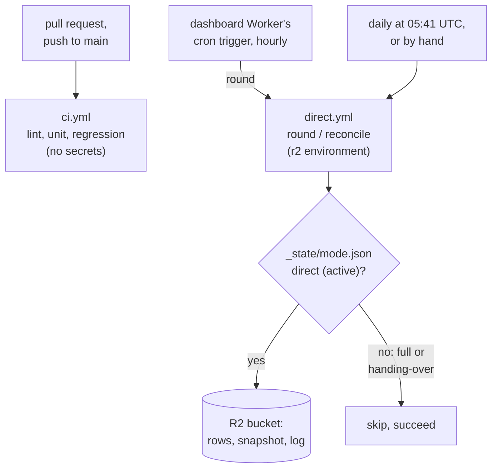

# Continuous integration

GitHub Actions runs `.github/workflows/ci.yml` on every pull request, on every push to `main`, and on demand (**Actions → CI → Run workflow**). It runs the same commands as a developer does locally, starting from a clean machine and the example settings.

A second workflow, `.github/workflows/direct.yml`, is not a check: it runs [direct mode on a schedule](#direct-mode-on-a-schedule).

## The jobs

| Job | Runs | Takes about | For |
| --- | --- | --- | --- |
| **Lint and unit tests** (`checks`) | `make install`, `make lint`, `make test` | 1 min | quick feedback; no Docker |
| **Regression** (`regression`) | the quick start (`cp .env.example .env`, `make install`, the dashboard and its test browser, `make up`), then `scripts/regression.py --skip performance` | usually 9–15 min | every layer but performance: lint, unit, integration, api, contract, e2e, dashboard, disruptive; then the traceability check |

The regression job uses `scripts/regression.py`, the script behind `make regression`, so CI and a local run cannot drift apart. It stops at the first failing layer, like locally.

**Performance is left out.** Shared runners vary too much for the ±15% repeatability check, so those tests run on a developer machine (`make regression`). In CI the layer shows as `skipped (--skip)`, and the three requirements covered only by it (REQ-BF-011, REQ-DASH-008, REQ-API-014) as *not run*, not as gaps. Every other requirement still needs a passing test, or the run fails.

## Reading a run

- **Run page:** the regression summary (layers, counts, coverage, traceability) is shown at the bottom of the run's **Summary**, even when the run fails.
- **Artifact `regression-reports`**, kept 30 days: JUnit XML per layer, the coverage report (`coverage-html/index.html`), `regression-summary.md` and the run's traceability matrix.
- **When a run fails:** the summary's *Failed tests* names them; the last 200 log lines of Kafka and PostgreSQL are printed in the last step.

To reproduce a CI run locally: `uv run python scripts/regression.py --skip performance` (with `make up` first, like `make regression`). With Claude Code, `/eh-test regression` runs the full local version, performance included.

## Security

- **No secrets in CI.** Tests use moto instead of R2, `wrangler dev --local` instead of Cloudflare, and a fake USGS feed; `ci.yml` references no `secrets`. A pull request from a fork can run it safely. Only the scheduled direct-mode workflow holds secrets ([below](#direct-mode-on-a-schedule)).
- **Read-only token** (`permissions: contents: read`), and checkout does not keep it (`persist-credentials: false`).
- **Actions pinned to commit SHAs**, with the release in a comment, chosen at least two weeks after their release. To update one, look up the new release's commit (`gh api repos/<owner>/<action>/commits/<tag> -q .sha`) and change the SHA and the comment together.
- **Deploying stays manual** (`make dashboard-deploy`); CI never holds Cloudflare credentials.

`tests/unit/test_ci.py` checks all of this in the workflow file (REQ-CI-001 to REQ-CI-004), and `tests/unit/test_direct_workflow.py` the scheduled workflow (REQ-CI-005).

## Cost and limits

$0. The repository is public, and GitHub-hosted runners are free for public repositories, with no limit on minutes. Concurrent runs for the same branch are cancelled when a newer commit arrives.

A ruleset on `main` requires both checks before a merge, and blocks force pushes and deleting the branch; the owner can bypass it in an emergency. It was created by the release (`make release`).

## Direct mode on a schedule

`.github/workflows/direct.yml` keeps the bucket and the dashboard current with no machine of ours running: [direct mode](architecture.md#direct-mode) needs only Python and R2 credentials.

| Job | When | Runs |
| --- | --- | --- |
| **Direct round** (`round`) | every hour at :17, started by the dashboard Worker's [cron trigger](#the-trigger) | `python -m earth_hub.direct once --skip-unless-direct`: one poller round, and catch-up if due (`make direct-once`) |
| **Direct reconcile** (`reconcile`) | every day, at 05:41 UTC | `python -m earth_hub.direct.reconcile --skip-unless-direct` (`make reconcile-direct`), then `python -m earth_hub.usgs_reconcile --skip-unless-direct --max-age-hours 2` ([against USGS](architecture.md#reconciliation-with-usgs)); either failing fails the run |

Both also run by hand: **Actions → Direct mode → Run workflow**, or `gh workflow run direct.yml -f job=round` (`job=reconcile`); `gh run list --workflow direct.yml` lists the runs. Each run's page shows the command's summary lines.

- **The mode marker switches it.** While the bucket is not in direct mode (full mode, or a handover running), both jobs skip and succeed: `make mode-full` pauses the schedule, `make mode-direct` resumes it. A handover that freezes the bucket during a round makes it skip too, without catch-up. Missing R2 settings still fail the run.
- **One direct process.** The schedule and a `make direct-run` elsewhere would both poll and take turns writing; stop `make direct-run` while the schedule is on. Runs never overlap (`concurrency`, never cancelled), and a run stops after 20 minutes; a round cut off is finished by the next, and its lock expires after 15.
- **Catch-up about every hour.** The workflow sets `CATCHUP_INTERVAL_SECONDS=3000` and `DELETED_CHECK_INTERVAL_SECONDS=82800`, a little early because runs start a little late, unevenly: the first round after that runs them.
- **Secrets.** R2 credentials (`R2_ACCOUNT_ID`, `R2_ACCESS_KEY_ID`, `R2_SECRET_ACCESS_KEY`, `R2_BUCKET`) are given only to the step that runs the command; `USGS_CONTACT` is a repository variable, the repository's address. Use an R2 token for this workflow only (Object Read & Write on the bucket), so it can be revoked alone. While the repository is private they are repository secrets (`gh secret set <NAME>`): GitHub Free has no environments for private repositories, and the jobs' `r2` environment holds none. Once it is public, move them to the `r2` environment, which only `main` can use (`gh secret set <NAME> --env r2`, which reads the value from the terminal). The workflow has no pull request or push trigger, pull requests from forks never get secrets, and a workflow run from any other branch cannot use the environment.
- **Freshness.** New events reach the bucket up to about an hour after USGS publishes them (a minute with `make direct-run`); none are lost, as the day feed lists the last 24 hours.
- **Cost.** Each run takes about 1–1½ minutes with uv's cache. While the repository is private, GitHub Free includes 2,000 Actions minutes a month, shared with CI: hourly rounds use about 720 to 1,440 of them, which is why the trigger runs hourly; Actions minutes are free for a public repository, where it can run every 15 minutes. The Cloudflare trigger is free (the Workers Free plan has 5 cron triggers). R2 operations are fewer than with `make direct-run`: 24 feed rounds a day instead of about 437 (`tests/unit/test_direct_budget.py`).
- **Failures** of the reconcile e-mail whoever last changed the workflow's schedule, as GitHub does for scheduled workflows; a failed round shows in **Actions**, a trigger GitHub refused in the Worker's logs on Cloudflare (**Workers → earth-hub → Logs**).
- **GitHub's schedule did not keep time** (DEF-052): while the repository was private it ran about one hourly slot in five, and on 21–22 October it ran none for over 8 hours, the 15-minute schedule included. Nothing is lost while rounds are missed (the day feed covers 24 hours, catch-up 30 days), but the dashboard goes stale. So the rounds are started from Cloudflare, whose cron triggers fire on time; the daily reconcile stays on GitHub's schedule and fails if no direct round has written for 2 hours.
- **60 days without activity.** GitHub switches off a public repository's scheduled workflows after 60 days with no activity in it, here the daily reconcile; a push, or **Actions → Direct mode → Enable workflow**, turns it back on.

### The trigger

The dashboard's Worker (`dashboard/src/worker.ts`) has a cron trigger, `17 * * * *` in `dashboard/wrangler.template.jsonc`: every hour it asks GitHub's API to run `direct.yml`'s round on `main` (`POST /repos/dienarvaez1/earth-hub/actions/workflows/direct.yml/dispatches`, `{"ref": "main", "inputs": {"job": "round"}}`). Its scheduled handler cannot be reached over HTTP, so the page still exposes only its two files. Without a token it starts nothing and says so in its log; a refusal fails the trigger. `tests/dashboard/test_dashboard_trigger.py` runs it under `wrangler dev --test-scheduled` against a local stand-in for GitHub (REQ-CI-006).

To set it up, once:

1. Create a fine-grained token (GitHub → **Settings → Developer settings → Fine-grained tokens**): repository access only `earth-hub`, permission **Actions: Read and write**, nothing else. It expires: note the date, and repeat these steps before it.
2. `cd dashboard && npx wrangler secret put GITHUB_TOKEN` reads it from the terminal and stores it on the Worker, never in the repository.
3. `make dashboard-deploy` deploys the trigger with the page.

To run every 15 minutes once the repository is public, change the cron to `2,17,32,47 * * * *` and deploy.

**With Claude Code:** `/eh-mode schedule` runs a round now, `/eh-mode runs` lists the recent runs, and `/eh-mode` says whether the schedule writes (direct mode) or skips (full mode).
