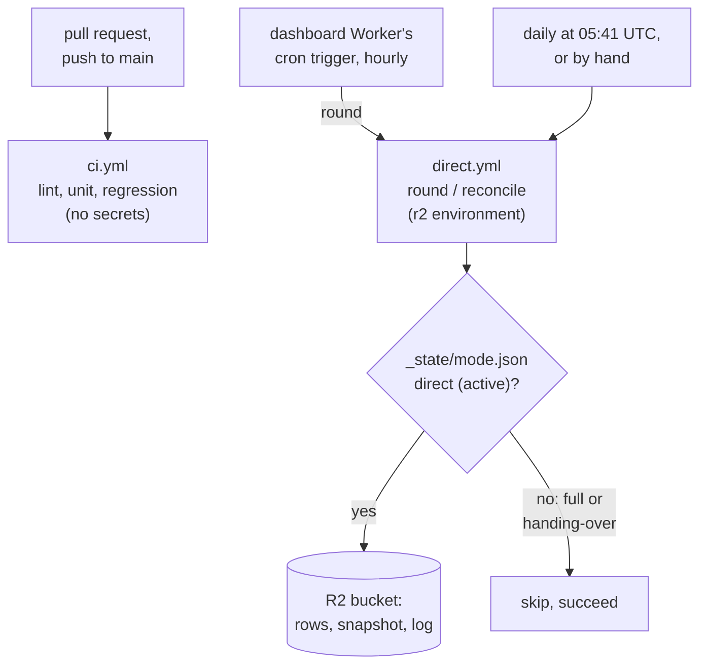

# Continuous integration

GitHub Actions runs `.github/workflows/ci.yml` on every pull request, on every push to `main`, and on demand (**Actions → CI → Run workflow**). It runs the same commands as a developer does locally, starting from a clean machine and the example settings.

A second workflow, `.github/workflows/direct.yml`, is not a check: it runs [direct mode on a schedule](#direct-mode-on-a-schedule).

## The jobs

| Job | Runs | Takes about | For |
| --- | --- | --- | --- |
| **Lint and unit tests** (`checks`) | `make install`, `make lint`, `make test` | 1 min | quick feedback; no Docker |
| **Regression layers** (`layers`) | the quick start (`cp .env.example .env`, `make install`, `make up`), then `scripts/regression.py --skip performance dashboard` | 6 min | lint, unit, integration, api, contract, e2e, disruptive |
| **Regression layers, dashboard** (`dashboard`, shards 1 and 2) | `cp .env.example .env`, `make install`, the dashboard and its test browser, then `scripts/regression.py --only dashboard --shard K/2` | 6 and 10 min | each half of the dashboard layer; no Docker |
| **Regression** (`regression`) | after the three above: their reports merged with `scripts/regression.py --skip performance --combine parts/*/` | 1 min | one summary, coverage and traceability check over every part; the check a merge requires |

The jobs use `scripts/regression.py`, the script behind `make regression`, so CI and a local run cannot drift apart. Each part stops at its first failing layer, like locally.

**Why in parts** (REQ-CI-008). The dashboard layer took 15 of the 21 minutes of a single regression job (about 12 s per browser test on a shared runner), so it runs beside the other layers, split in two by `pytest --shard K/N` (`tests/support/shard.py`: the Kth, (K+N)th, ... test collected, so the shards run each test once). A part runs no traceability check, since it sees only some tests; `--combine` does it over all of them. **Regression** is the check a merge requires (and `make release`'s ruleset names), so it runs unless the run was cancelled, even when a part failed: a required check that was skipped would count as passed. A part, or a shard, that failed or wrote no summary fails it. A run takes about 10 minutes instead of 21. Shard 2 is the longer, as the tests over the large synthetic datasets fell to it. The price is more runner time, about 26 minutes per run instead of 22, as each job installs its own tools; with `shard: [1]` in the matrix (and `--shard "$SHARD/1"`) the dashboard runs in one job again.

**Performance is left out.** Shared runners vary too much for the ±15% repeatability check, so those tests run on a developer machine (`make regression`). In CI the layer shows as `skipped (--skip)`, and the three requirements covered only by it (REQ-BF-011, REQ-DASH-008, REQ-API-014) as *not run*, not as gaps. Every other requirement still needs a passing test, or the run fails.

## Reading a run

- **Run page:** the regression summary (layers, counts, coverage, traceability) is shown at the bottom of the run's **Summary**, even when the run fails.
- **Artifact `regression-reports`**, kept 30 days: JUnit XML per layer (`junit-dashboard-1of2.xml` and `-2of2` for the shards), the coverage report of every part combined (`coverage-html/index.html`), `regression-summary.md` and the run's traceability matrix. Each part's own reports are kept too, as `part-layers`, `part-dashboard-1` and `part-dashboard-2`.
- **When a run fails:** the summary's *Failed tests* names them, and a part that never reported shows as *not run*; the last 200 log lines of Kafka and PostgreSQL are printed in the last step of **Regression layers**.

To reproduce a CI run locally: `uv run python scripts/regression.py --skip performance` (with `make up` first, like `make regression`), all in one go. With Claude Code, `/eh-test regression` runs the full local version, performance included.

## Security

- **No secrets in CI.** Tests use moto instead of R2, `wrangler dev --local` instead of Cloudflare, and a fake USGS feed; `ci.yml` references no `secrets`. A pull request from a fork can run it safely. Only the scheduled direct-mode workflow holds secrets ([below](#direct-mode-on-a-schedule)).
- **Read-only token** (`permissions: contents: read`), and checkout does not keep it (`persist-credentials: false`).
- **Actions pinned to commit SHAs**, with the release in a comment, chosen at least two weeks after their release. To update one, look up the new release's commit (`gh api repos/<owner>/<action>/commits/<tag> -q .sha`) and change the SHA and the comment together.
- **Deploying stays manual** (`make dashboard-deploy`); CI never holds Cloudflare credentials.

`tests/unit/test_ci.py` checks all of this in the workflow file (REQ-CI-001 to REQ-CI-004), and `tests/unit/test_direct_workflow.py` the scheduled workflow (REQ-CI-005).

## Cost and limits

$0. The repository is public, and GitHub-hosted runners are free for public repositories, with no limit on minutes. Concurrent runs for the same branch are cancelled when a newer commit arrives.

A ruleset on `main` requires both checks before a merge, and blocks force pushes and deleting the branch; the owner can bypass it in an emergency. It was created by the release (`make release`).

## Direct mode on a schedule

`.github/workflows/direct.yml` keeps the bucket and the dashboard current with no machine of ours running: [direct mode](architecture.md#direct-mode) needs only Python and R2 credentials.

| Job | When | Runs |
| --- | --- | --- |
| **Direct round** (`round`) | every hour at :17, started by the dashboard Worker's [cron trigger](#the-trigger) | `python -m earth_hub.direct once --skip-unless-direct`: one poller round, and catch-up if due (`make direct-once`) |
| **Trigger token** (`token`) | once a day, when the trigger passes the days its token has left | Fails within 14 days of the expiry, so GitHub e-mails the token's owner ([the reminder](#the-trigger)); no secrets |
| **Direct reconcile** (`reconcile`) | every day, at 05:41 UTC | `python -m earth_hub.direct.reconcile --skip-unless-direct` (`make reconcile-direct`), then `python -m earth_hub.usgs_reconcile --skip-unless-direct --max-age-hours 2` ([against USGS](architecture.md#reconciliation-with-usgs)); either failing fails the run |

Both also run by hand: **Actions → Direct mode → Run workflow**, or `gh workflow run direct.yml -f job=round` (`job=reconcile`); `gh run list --workflow direct.yml` lists the runs. Each run's page shows the command's summary lines.

- **The mode marker switches it.** While the bucket is not in direct mode (full mode, or a handover running), both jobs skip and succeed: `make mode-full` pauses the schedule, `make mode-direct` resumes it. A handover that freezes the bucket during a round makes it skip too, without catch-up. Missing R2 settings still fail the run.
- **One direct process.** The schedule and a `make direct-run` elsewhere would both poll and take turns writing; stop `make direct-run` while the schedule is on. Runs never overlap (`concurrency`, never cancelled), and a run stops after 20 minutes; a round cut off is finished by the next, and its lock expires after 15.
- **Catch-up about every hour.** The workflow sets `CATCHUP_INTERVAL_SECONDS=3000` and `DELETED_CHECK_INTERVAL_SECONDS=82800`, a little early because runs start a little late, unevenly: the first round after that runs them.
- **Secrets.** R2 credentials (`R2_ACCOUNT_ID`, `R2_ACCESS_KEY_ID`, `R2_SECRET_ACCESS_KEY`, `R2_BUCKET`) are given only to the step that runs the command; `USGS_CONTACT` is a repository variable, the repository's address. Use an R2 token for this workflow only (Object Read & Write on the bucket), so it can be revoked alone. While the repository is private they are repository secrets (`gh secret set <NAME>`): GitHub Free has no environments for private repositories, and the jobs' `r2` environment holds none. Once it is public, move them to the `r2` environment, which only `main` can use (`gh secret set <NAME> --env r2`, which reads the value from the terminal). The workflow has no pull request or push trigger, pull requests from forks never get secrets, and a workflow run from any other branch cannot use the environment.
- **Freshness.** New events reach the bucket up to about an hour after USGS publishes them (a minute with `make direct-run`); none are lost, as the day feed lists the last 24 hours.
- **Cost.** Each run takes about 1–1½ minutes with uv's cache. While the repository is private, GitHub Free includes 2,000 Actions minutes a month, shared with CI: hourly rounds use about 720 to 1,440 of them, which is why the trigger runs hourly; Actions minutes are free for a public repository, where it can run every 15 minutes. The Cloudflare trigger is free (the Workers Free plan has 5 cron triggers). R2 operations are fewer than with `make direct-run`: 24 feed rounds a day instead of about 437 (`tests/unit/test_direct_budget.py`).
- **Failures** of the reconcile e-mail whoever last changed the workflow's schedule, as GitHub does for scheduled workflows; a failed round shows in **Actions**, a trigger GitHub refused in the Worker's logs on Cloudflare (**Workers → earth-hub → Logs**).
- **GitHub's schedule did not keep time** (DEF-052): while the repository was private it ran about one hourly slot in five, and on 21–22 October it ran none for over 8 hours, the 15-minute schedule included. Nothing is lost while rounds are missed (the day feed covers 24 hours, catch-up 30 days), but the dashboard goes stale. So the rounds are started from Cloudflare, whose cron triggers fire on time; the daily reconcile stays on GitHub's schedule and fails if no direct round has written for 2 hours.
- **60 days without activity.** GitHub switches off a public repository's scheduled workflows after 60 days with no activity in it, here the daily reconcile; a push, or **Actions → Direct mode → Enable workflow**, turns it back on.

### The trigger

The dashboard's Worker (`dashboard/src/worker.ts`) has a cron trigger, `17 * * * *` in `dashboard/wrangler.template.jsonc`: every hour it asks GitHub's API to run `direct.yml`'s round on `main` (`POST /repos/dienarvaez1/earth-hub/actions/workflows/direct.yml/dispatches`, `{"ref": "main", "inputs": {"job": "round"}}`). Its scheduled handler cannot be reached over HTTP, so the page still exposes only its two files. Without a token it starts nothing and says so in its log; a refusal fails the trigger. `tests/dashboard/test_dashboard_trigger.py` runs it under `wrangler dev --test-scheduled` against a local stand-in for GitHub (REQ-CI-006).

To set it up, once, then again before the token expires: run `make trigger-token` in a terminal (`scripts/trigger_token.py`), then `make dashboard-deploy` the first time.

1. It opens GitHub's form for a fine-grained token with its name, description and **Actions: Read and write** filled in; you pick repository access (only `earth-hub`) and the expiry, and note the date: rounds stop when it passes.
2. It reads the token without showing it and checks it can see `direct.yml` (a read, which starts nothing): a token GitHub refuses, or one without access to the repository, is not stored.
3. It stores it as the Worker's `GITHUB_TOKEN` secret through `wrangler secret put`'s standard input: never printed, written to a file or put on a command line.
4. It prints the expiry GitHub states for the token.

By hand, the same: create the token in **Settings → Developer settings → Fine-grained tokens**, then `cd dashboard && npx wrangler secret put GITHUB_TOKEN`, which reads it from the terminal.

To run every 15 minutes once the repository is public, change the cron to `2,17,32,47 * * * *` and deploy.

**The reminder to renew it** (REQ-CI-007). GitHub states a token's expiry on every reply to it (`GitHub-Authentication-Token-Expiration`). Once a day, the 08:17 UTC trigger reads it (a read of the workflow, which starts nothing) and passes the days left with the round, as the input `token_days_left`. The workflow's **Trigger token** job, which has no secrets, fails when 14 days or fewer are left, with *"The dashboard trigger's GitHub token expires in N days: run make trigger-token"*; GitHub e-mails a failed run to whoever started it, the token's owner (check **Settings → Notifications → Actions**: failed workflows, e-mail). The round runs as usual, and the Worker logs the same warning. After `make trigger-token`, the next day's check passes. Until then it adds a minute of Actions time a day; the job is skipped, at no cost, on the other runs.

**With Claude Code:** `/eh-mode schedule` runs a round now, `/eh-mode runs` lists the recent runs, and `/eh-mode` says whether the schedule writes (direct mode) or skips (full mode).
